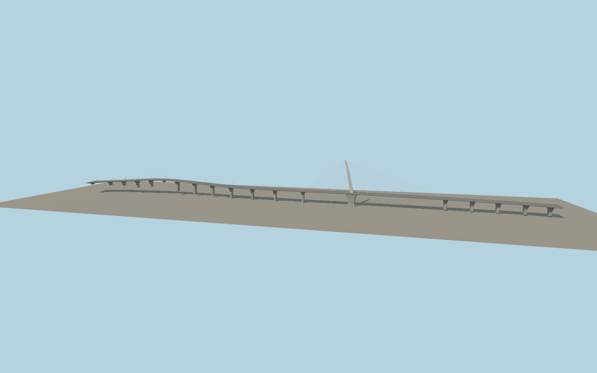

# World Cup Bridge

A single pale mast leans toward the south bank over the Han. Unequal fans of stays run in the median above the six-lane deck. A flared tower pier and repeating concrete approach piers support the crossing, which curves into the interchanges at either end.

Run `node packages/worldgen/scripts/generate-world-cup-bridge.mjs` to rebuild the source master. Append `--check` to compare the exact bytes. Use `--ids=world_cup_bridge` for targeted import, LOD generation and placement.

The mapped outline and carriageway traces set the deck geometry. Mast dimensions, stay spacing and individual piers use exterior photo estimates.

The south approach deck grade clears a ridge in the standard viewer terrain. Elevations and pier spacing are visual approximations.

Original geometry follows the repository license. Map data is © OpenStreetMap contributors under ODbL-1.0 via Protomaps. Terrain samples are described in terrain-grid.json. Ordinary pictures stay local and are not redistributed or used as textures. Current acceptance is recorded in qa.json.
