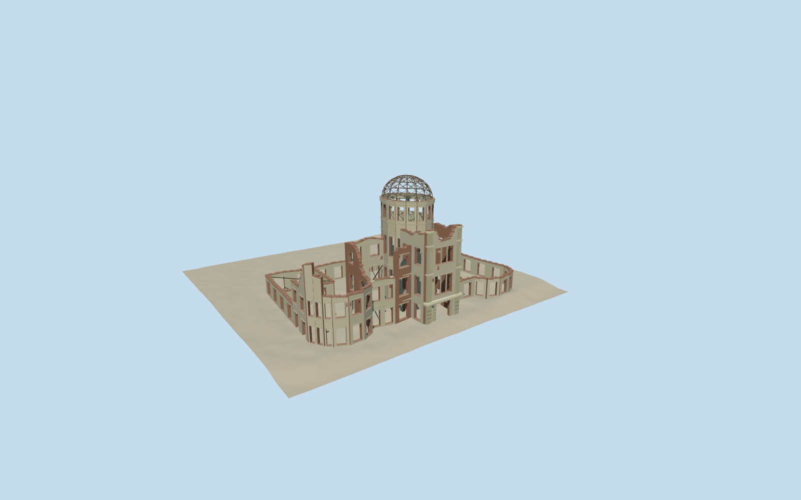

# Hiroshima Peace Memorial

Preserved roofless exhibition hall ruin: asymmetrical jagged red-brick/grey plaster walls, actual open window and doorway holes, curved front end bays, projecting stone entrance, tall perforated oval masonry drum, bare skeletal steel dome, open rear courtyard and preservation braces. No reconstruction of original roofs or floors.

Authoring state: **review-in-qa.json**. Current completion evidence is in [qa.json](qa.json) and the [local 100 ledger](../../../../qualla-structures/batches/PROGRESS.md).

- [Hiroshima Peace Memorial](https://qualla.com/hiroshima-peace-memorial/)

Original medium-fi representation of the preserved ruin, reviewed first against three cleared public-domain Qualla photographs and a verified creator-CC0 riverfront original. Mapped vector parts control the generalized envelope and courtyard. Earlier attribution-licensed imagery, uncleared official drawings and aerial imagery are excluded from current approval. Nominal25m height and roughly11m by8m by4m dome dimensions guide scale from official text. Wall heights, jagged outlines, masonry patches, hidden windows and exact steel/bracing layout remain estimates, not a measured conservation survey.

No original complete roofs, floors or main staircase reconstructed. Small surviving south-court spiral stair and modern preservation rods are simplified. River walls, surrounding city, park trees/fences/signs and temporary protective coverings excluded.

Photographic pixels not redistributed. GSI independent elevation sources retained unchanged for the bounded64m land-side ground review. Current foundations/contact and signed orientation reviewed as a preview; river bed and other host terrain compatibility remain unverified. Footprint replacement disabled.

Build: `node packages/worldgen/scripts/generate-authored-places.mjs --ids=hiroshima_peace_memorial`. Add `--check` to verify exact regeneration. 19410 triangles; 4 materials; no embedded photographs.
