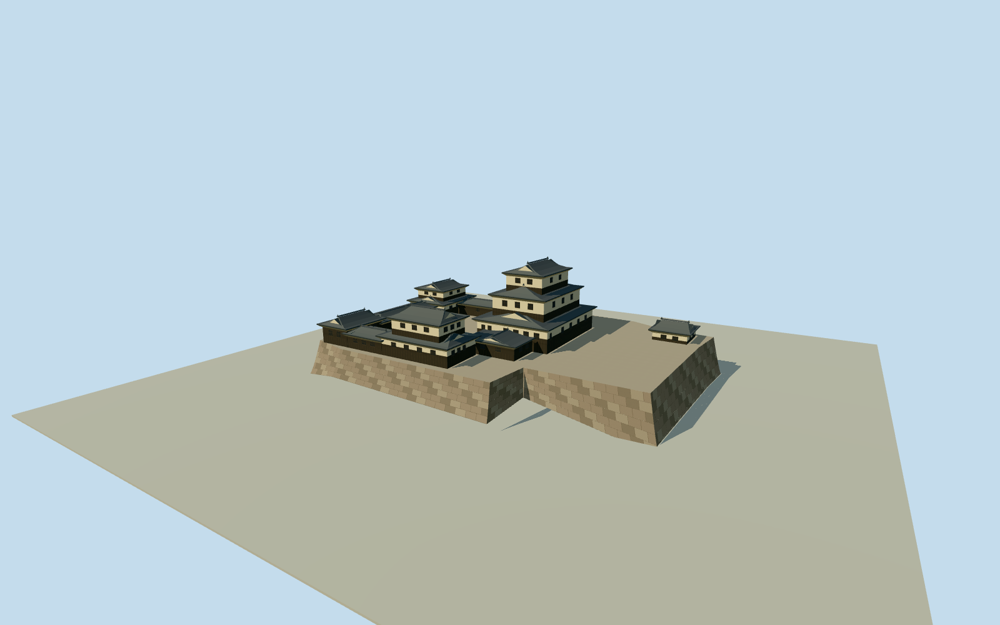

# Matsuyama Castle (Iyo)

Matsuyama Castle in Ehime, including its tiered main and small keeps, adjoining turrets and wooden galleries over a battered stone platform.

Authoring state: **review-in-qa.json**. Current completion evidence is in [qa.json](qa.json) and the [completion ledger](../../../../qualla-structures/batches/qualla-003.PROGRESS.md).

- [Matsuyama Castle (Iyo)](https://qualla.com/matsuyama-castle-iyo/)

The January 2009 reconstruction covers the connected upper keep and its neighboring Tenjin turret. Lower baileys and more distant gate complexes are outside its scope.

The roof tiers, wall palette and battered stonework come from two cleared photographs. Connections, unseen wall openings and tower heights are bounded estimates.

The summit terrain was kept unchanged. Part of the stone wall follows mapped survey controls, with the remaining faces and height approximated from the photographed forecourt.

Build: `node content/worldgen/source/places/wy/wyn/matsuyama_castle_iyo/models/generate-matsuyama-castle-iyo.mjs`. Add `--check` to verify exact regeneration. 8305 triangles; 5 materials; no embedded photographs.
