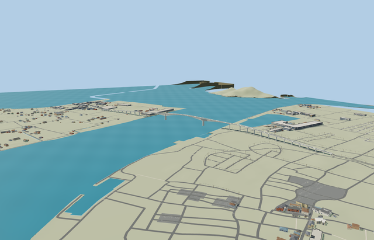

# Eshima Ohashi Bridge — completed current medium-fi pass

Reviewed 2026-10-25. **Complete scoped bridge exterior and approximate native placement; detailed source preserved.**

## Geometry and shared materials

Inspected 74 current frames in one author/inspect/fix pass: 14 portable, 14 shared, 30 medium-fi and 16 native. Full curved Tottori approach, unequal road grades and crest, five-span rigid-frame silhouette, deep tapered girders, full-height oval main piers, every approach pier, opposite maintenance bays, footways and open rails remain. The previous automatic skyline had 348.35m reported error; all four current browser models are authored from the original alignment/profile. Added skyline stations where actual mesh rays caught excessive central intrados interpolation. Detailed source (814362 triangles, 60454680 bytes) and canonical runtime remain byte-exact.

Two existing 256px shared graphs, concrete_plain and metal_painted, supply reusable concrete grain and painted fittings with metric UVs. Runtime roadway and markings also bind these graphs using restrained component tints. Near transparent blue bay screens use a small local PBR glazing material with no texture image; source master preserves its existing palette roadway/marking materials. No private texture atlas, embedded images or copied photographic pixels. Textured LODs use two/three draws and read each shared graph once; skyline bakes shared means into one vertex-color draw. Separate GPU streams and full geometry disposal pass.

| Level | Triangles | Bytes | Draws |
| --- | ---: | ---: | ---: |
| skyline | 980 | 103924 | 1 |
| district | 3470 | 337428 | 2 |
| street | 15764 | 1525236 | 3 |
| closeup | 58116 | 5717412 | 3 |

Four authored LODs: 980/3470/15764/58116 triangles. Initial skyline + district 441352 bytes; closeup 5717412 bytes. Skyline omits narrow lamps and uses coarse pier sections; district uses representative lamps. Street/closeup retain source lamp rhythm, raised footways and transparent supported bay screens; posts use12m/2m spacing. Fine infill, form ties, grate bars, comb teeth and navigation lettering remain in the master. Japanese procedural neighbors, economy/high, noon/late, silhouette and all four transitions were inspected. Physical laptop/phone timings remain pending.

## Placement and preservation

Approximate native fit at [133.200518112,35.519148008], heading0.360355642256; +X from Shimane toward Tottori. Exact-QID source map alignment retains the curved eastern approach. Native lake-plane zero,5.2/7.7m end levels and44.7m crest remain provisional source reconstructions, not a tidal/geodetic conversion. Explicit local deckEndpoints place connections at the real curved ends instead of intersections withZ0. Native road heights0.25m outside the two ends are5.173/7.649m, within0.052m of the deck. Coarse shore terrain is0/about1.93m; the20m supported approach blend is inferred and noticeably steeper than a surveyed road. Native approach widths/footways are generic map rendering, not an exact continuation of the authored bridge section.

All 644 resident / 786 wider mapped buildings, 450 independent transportation records, every original DEM sample and native water/shoreline behavior remain. Only the mapped crossing and its two directly shared outward road approaches receive clipping/height hints. Unrelated fragments sharing the same tile feature IDs remain exact. Failed load retains the original procedural crossing without supports; unload releases all model/support geometry and restores native content. Fixture/engine hashes are pinned. Curved endpoint support also passes41 targeted Earth tests (rotation, nonuniform scale, malformed endpoints and existing bridge behavior); affected package typecheck and seven-file formatter check pass. Full engine CI was not rerun; previously recorded livery-schema failures remain outside this model pass.

## Checks

Targeted generator --check, strict medium-fi, scene validation and 30-tick simulation pass. Six GLBs have zero Khronos errors/warnings; 786 probes pass. All 74 inspected frames bind current source/runtime/LOD and fixture/engine hashes. Bulk captures stay local; two small previews stay with source.

## Ordinary references and limits

Inspected [tourism side view](https://www.tottori-guide.jp/files/27513.jpg) and [telephoto road view](https://www.tottori-guide.jp/files/27514.JPG?1394764001=). No photo pixels redistributed. Retained original nominal engineering dimensions without bespoke re-research; telephoto compression does not determine slope. Standard2026-10-20 Protomaps/Mapzen establishes native fit. Lake datum, shore grades and native approach widths remain approximate. Physical device timings remain pending.
