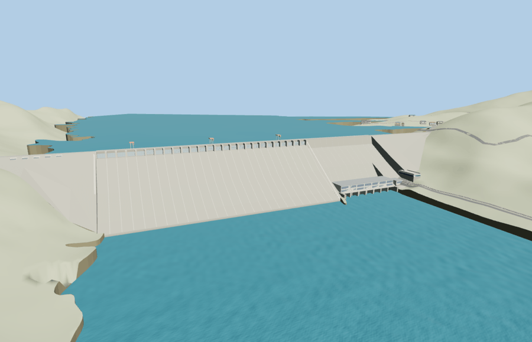

# Supung Dam

The reconstruction includes the 899.5 m gravity dam, all 26 recessed spillway gates and their continuous apron, the seven-section southeast powerhouse and tailrace recesses, three crest gantries, five sealed log sluices and both concrete abutment ties.

The signed placement fixes the dam crest at 126.4 m. The viewer renders a 123.3 m operating pool and 31.16 m Yalu tailwater. The 26 spillway bays and the seven-section generating hall stand above the fitted apron. The mapped service building and both the road and rail crossings remain in place.

The Earth fixture retains 51 native road records and 56 nearby building features. The ground opening follows the concrete walls, apron and powerhouse. Failed loading preserves the native layers. Eviction restores the ground and releases the model geometry.

| Detail level | Triangles | Download bytes | Draws |
| --- | ---: | ---: | ---: |
| skyline | 886 | 69,356 | 1 |
| district | 2,594 | 213,536 | 6 |
| street | 4,518 | 374,992 | 6 |
| closeup | 4,686 | 389,104 | 6 |

Skyline and district total 282,892 bytes. Six GLBs pass Khronos validation and contain zero embedded images. Six shared material graphs bind in the viewer. The review covers 79 renders and 330 geographic samples.

The tailwater, apron and local bank grades are representative exterior estimates. Some outer shore edges remain abrupt in the coarse terrain. The model shows static gates and machinery.

The host supplies the matching Protomaps feature IDs and terrain samples fine enough to resolve the graded apron.

[Mapped site frame](map-frame.json) · [Terrain and water fit](site-fit.json) · [QA evidence](qa.json)
