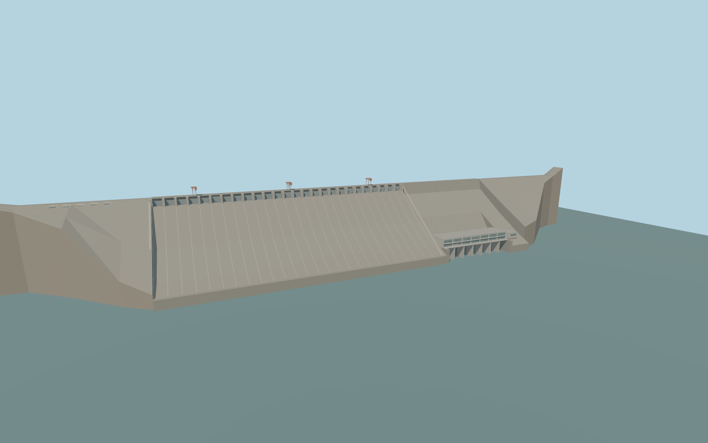

# Supung Dam

Sup’ung Dam’s 899.5 m gravity wall, 26 spillway bays, three crest gantries, five sealed log sluices, the seven-section powerhouse and both concrete abutments.

Rebuild: `node packages/worldgen/scripts/generate-supung-dam.mjs`;append `--check` for exact source bytes. Select import/LOD/placement with `--ids=supung_dam`. Detailed source and four browser tiers are separate ignored GLB outputs.

The fixed sea-level datum is 81.298449 m. The documented crest elevation is 126.4 m. The representative operating pool is 123.3 m and the tailwater is 31.16 m.

The model preserves the mapped placement and documented concrete wall height. In the sampled-water fixture the upstream water lies about 35–43 m below the operating pool, exposing much more of the upstream wall.

Bounded Earth terrain repairs address invalid lows near the apron and shoreline. The retained standard elevation field supplies the surrounding slopes.

Gate settings, the closed log sluice panels and the powerhouse facade are exterior reconstructions. The separately mapped service building and the downstream road and rail crossing remain native.

Original geometry:repository license. Map:© OpenStreetMap contributors,ODbL-1.0;Protomaps. Standard terrain:terrain-grid.json. Ordinary pictures stay local and are not redistributed or used as textures. Current acceptance:qa.json.
