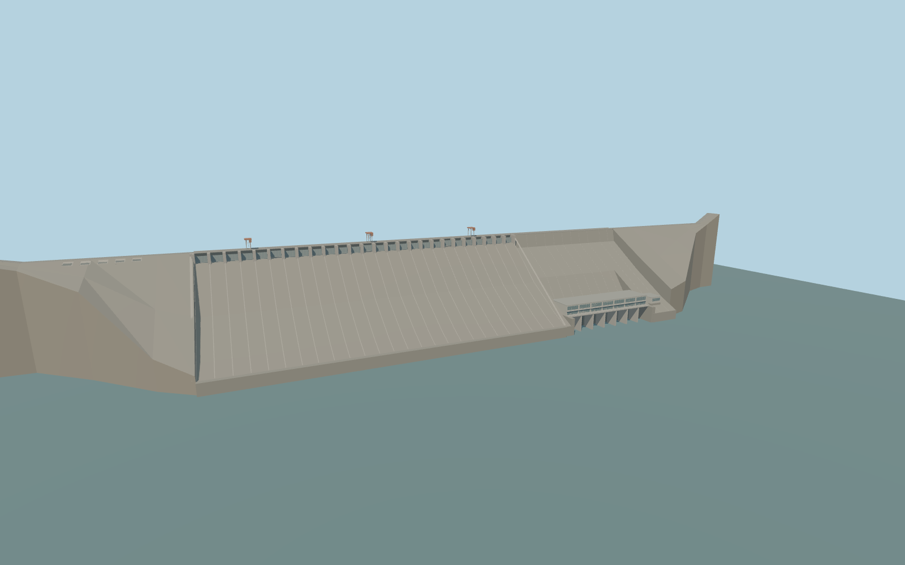

# Supung Dam

Sup’ung Dam’s 899.5 m gravity wall, 26 spillway bays, three crest gantries, five sealed log sluices, the seven-section powerhouse and both concrete abutments.

Rebuild: `node packages/worldgen/scripts/generate-supung-dam.mjs`;append `--check` for exact source bytes. Select import/LOD/placement with `--ids=supung_dam`. Detailed source and four browser tiers are separate ignored GLB outputs.

The documented crest is 126.4 m and operating pool 123.3 m. The standard terrain reference is 81.30 m and the production sampler on the retained windows gives 80.38–88.39 m in the reservoir and 31.16–33.15 m downstream.

The model preserves the mapped placement and documented concrete wall height. In the sampled-water fixture the upstream water lies about 35–43 m below the operating pool, exposing much more of the upstream wall.

The standard Terrarium field contains isolated anomalous elevations at the apron and nearby shore. The raw source terrain is preserved and runtime site acceptance remains pending.

Gate settings, the closed log sluice panels and the powerhouse facade are exterior reconstructions. The separately mapped service building and the downstream road and rail crossing remain native.

Original geometry:repository license. Map:© OpenStreetMap contributors,ODbL-1.0;Protomaps. Standard terrain:terrain-grid.json. Ordinary pictures stay local and are not redistributed or used as textures. Current acceptance:qa.json.
