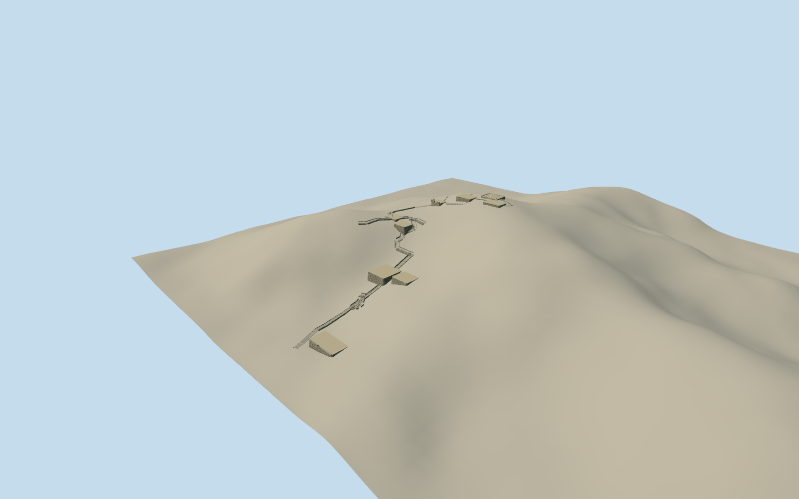

# Azuchi Castle ruins

Surviving Azuchi archaeological masonry: open main keep foundation with broken low rubble perimeter and exposed pillar-base field; Honmaru/Ninomaru terraces, breached turning Kuroganemon gate, retained residence courts, lower Otemon remnants and the long worn Otemichi stone stair/landing approach. Native named point and actual path controls; bounded wall footprints and architectural detail are photographic estimates. No reconstructed lost tower or replica.

Authoring state: **review-in-qa.json**. Current completion evidence is in [qa.json](qa.json) and the [completion ledger](../../../../qualla-structures/batches/qualla-002.PROGRESS.md).

- [Azuchi Castle: The Fortress That Renamed an Era](https://qualla.com/azuchi-castle/)

Named basemap AzuchiCastle/keepbase/Ninomaru/Kuroganemon/residence/Otemon point controls and actual stone-approach path network establish the surviving archaeological ensemble. No surveyed wall/terrace or keep-base polygon is supplied. Individual bounded foundation/wall footprints, platform levels/courses/pillar-base grid and stair widths are explicit estimates from the9accepted ruin originals; preserve actual approach network and leave forest/natural hillside unmodeled. Providerpathfeatures can merge several original ways and are not an exact originalOSMway census. Site-outline below is an estimated construction envelope, not an extrudable native castle parcel or surviving tower footprint.

Current surviving ruins only. The vanished 1579 keep, gilded upper rooms, complete roofs/palaces/gates and modern museum/Ise replicas are excluded, as are separate Sokenji temple/pagoda/gate, tomb/sculpture/tablet collections, interpretive sign artwork, people and forest. No photographic textures.

Main keep/courtyard/residence/gateway footprints, widths, wall heights, battered sections, access gaps and individual pillar/stone counts are explicit medium-fi photographic estimates around named archaeological controls, not measured or surveyed ruin polygons. Exact stair landings, historical construction phases and concealed walls remain approximate.

The saved unmodified coarse raw relief spans about100m of hillside. Distributed levels use that relief relative to the fixed lower-gate datum; bounded retained soil/platform caps are intrinsic architecture. Level court tops use the maximum sampled perimeter height, so terrace heights/precise thresholds may differ from actual surveyed remains. No whole natural hillside or vegetation is part of the GLB. Flat asset-library views therefore omit its supporting geographic hillside; portable and context scenes retain the raw review terrain. Host terrain/contact remains approximate.

Four cleared published Qualla public-domain ruin originals and five Mont Blank rich own-work CC0 originals establish surviving rubble, pillar bases, worn steps, terraces and breached gateways. The photographed interpretive map/artwork and other licensed/historical/religious imagery are unused. Stone layouts/colors and hidden return faces are representative; no underlying artwork or exact photographic texture copied.

Build: `node packages/worldgen/scripts/generate-authored-places.mjs --ids=azuchi_castle`. Add `--check` to verify exact regeneration. 58760 triangles; 3 materials; no embedded photographs.
