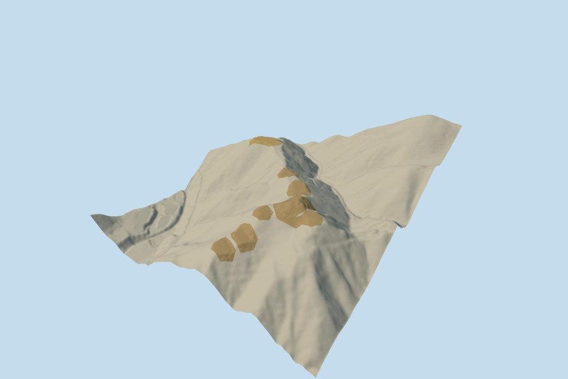

# Chihaya Castle

A present-ground reconstruction of the surviving castle earthworks, assembled from nine independent geographic models: the fourth, third, second and main bailey grounds; southeastern enclosure; southwestern terrace; two Chaya-no-dan steps; and the main bailey banks. Each component has four authored detail levels, its own regional catalog placement, reviewed public-domain Qualla references and a story annotation.

The original 512 m numerical terrain field, geographic anchor, heading and vertical datum predate all member geometry and remain unchanged. All nine assembly transforms are identity. The main surface stays uneven; possible former ditch cuts are not sufficiently clear in the current primary description to reconstruct. No flat medieval summit, lost keep or imaginary moat is added. Hidden underside closure is rendering geometry, not an ancient wall.

Eight component perimeters are explicit authoring estimates, generally within a stated 10 m edge allowance. The fourth uses the original lower-context polygon, which is not the whole castle or a surveyed archaeological boundary. Current terrain sampling and the 3 m source-grade allowance are not measured archaeological error bounds. The bank's distant mesh permits up to 0.5 m interpolation while remaining above the unchanged source field; close ground retains the original 2 m surface topology. Minor gaps and overlaps between estimated perimeter edges remain approximate.

Primary village factual text establishes principal ordering, surrounding northwest/south enclosures, uneven current main ground and indistinct former ditch cuts. The Nankou Research Society's first-person site-visit account associates Chaya-no-dan with the later Zondokan complex. Original mapped routes and later buildings supply numerical location context. Later shrines, offices, picnic shelter and Zondokan buildings, signs, steles and vegetation are separate from this castle-remains model. The natural hill is review context, not a castle solid.

Appearance references start with the already published Qualla corpus. Exact creator-released public-domain photographic originals and their original native grants remain pinned per member; no questionable photograph, protected map/plan pixels or photographic texture was used. Original numerical elevation and map data retain their source attribution.

Two current complete group views were personally inspected in this authoring pass. Existing member geometry, fields, frames, sections and approvals remain bound without another individual review pass. This is an approximate current digital-terrain snapshot, not a surveyed medieval reconstruction or verified live-host replacement. Current-world activation remains disabled.

[Qualla story](https://qualla.com/chihaya-castle/)

Regenerate the assembly with `node content/worldgen/source/places/xn/xn0/chihaya_castle/generate-collection-scene.mjs`; `--check` verifies the original field and existing member bindings without generating their geometry.
