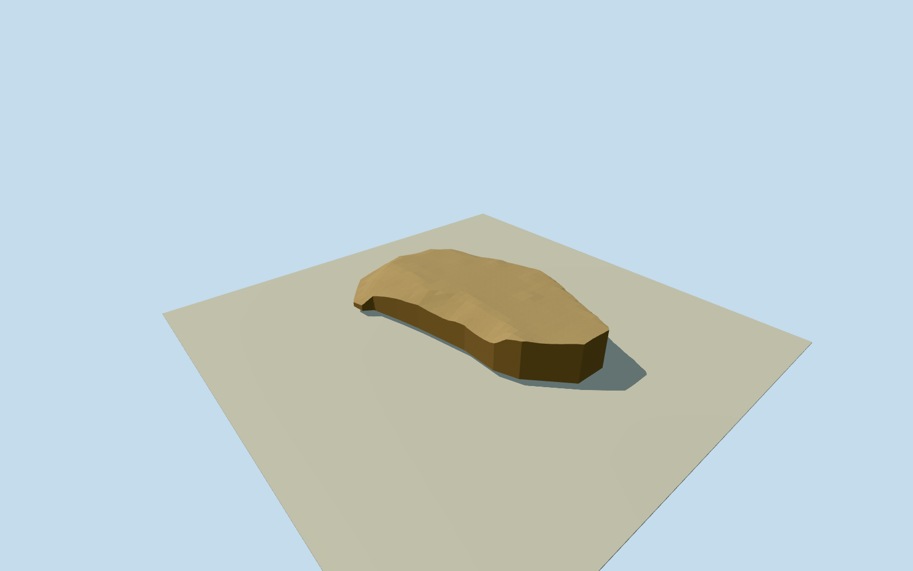

# Chihaya fourth bailey

Mapped surviving levelled fourth-bailey earthwork at Chihaya Castle: complete retained20-corner lower precinct ground surface and edge slopes, shaped by original numerical elevation values. No surviving keep is claimed. Upper enclosures, ridge ditch, modern shrine/teahouse, signs, steles, trees, whole natural hill and approach staircase are outside this constituent; whole Chihaya Castle remains unfinished.

Authoring state: **review-in-qa.json**. Current completion evidence is in [qa.json](qa.json) and the [completion ledger](../../../../qualla-structures/batches/qualla-002.PROGRESS.md).

- [Chihaya Castle: The Mountain Fortress That Broke an Army](https://qualla.com/chihaya-castle/)

Mapped surviving levelled fourth-bailey earthwork at Chihaya Castle: complete retained20-corner lower precinct ground surface and edge slopes, shaped by original numerical elevation values. No surviving keep is claimed. Upper enclosures, ridge ditch, modern shrine/teahouse, signs, steles, trees, whole natural hill and approach staircase are outside this constituent; whole Chihaya Castle remains unfinished.

Qualla-first53families/zero conflicts. Exact already-published2009creatorPD-self original visually inspected/nativeSHA1matched. Bare ochre ground and low sloping earthwork character used; foreground modern sign/stele, shrine, huts, trees and photograph shadows not modeled. Official village2018newsletter identifies the flat area reached by the long steps as the artificially levelled fourth bailey. Numerical site boundary is contextual mapped extent, not an archaeological survey or certified medieval bank line. Actual source terrain sampled without levelling, invented ramparts, source shifting or host fitting.

Nominal10m archaeological-edge/identity allowance and2m source-ground uncertainty are authoring allowances, not measured accuracy bounds. Native map outline controls this constituent extent; no assertion that its line is the exact medieval defence edge.

Original full512m/257x257source field was frozen before geometry. Member inherits the same original native coordinates/anchor/axes and full numerical field byte-for-byte.589of66049data samples use original GSI coarser datasets in the published no-data hierarchy; none are invented. All model-domain samples are separately classified during geometry review.

Top follows the preserved2m numerical field, with a predeclared0.045m rendering separation. Closed underside is an opaque mesh closure below source minimum, not an excavated/surveyed underground foundation. No flat building floor or wall/roof height is invented. Four authored source-grid clipping densities retain original terrain topology; distant cells merge only within0.041/0.02/0.008m source interpolation tolerance and closeup retains2m cells. Source sampling resolution is not archaeological accuracy.

Bare earth color/gravel response are coarse material estimates. No photo textures, protected maps, later shrine/teahouse/sign/stele substitutes, trees or whole natural hill. Approximate geographic snapshot has no surveyed vertical tie to live host/Terrarium terrain; current-world activation remains off.

Skyline retains the full source-conforming upper earthwork surface and all20mapped corners, and drops the buried artificial mesh closure. Other three levels retain the closed rendering underside with increasing edge sampling; the underground closure is not an archaeological wall. Skyline source interpolation tolerance0.041m remains below the original0.045m display separation. No field or pose changed.

Build: `node content/worldgen/source/places/xn/xn0/chihaya_fourth_bailey/models/generate-house.mjs`. Add `--check` to verify exact regeneration. 1594 triangles; 2 materials; no embedded photographs.
