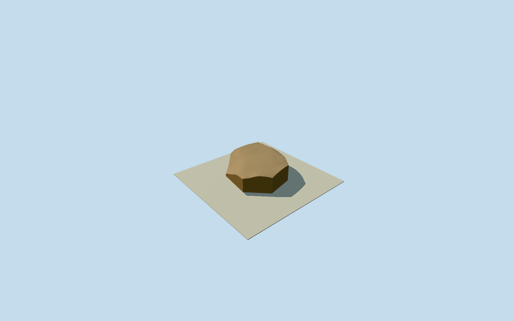

# Chihaya southeastern enclosure

Whole declared surviving southeastern enclosure ground constituent at Chihaya Castle, retaining present numerical terrain shape and slope breaks within the explicit estimated precinct perimeter. Present lower platform southeast of the uneven main bailey. Original numerical field shows a separate low-slope platform around[160,128] below the main summit; native route397892993 skirts its southern edge. Village factual text describes surrounding enclosures south of the main precinct. The bounded perimeter is an explicit present-ground estimate, not a surveyed named medieval defence line. Later shrine/office/sign/stele/trees and all standing keep reconstructions excluded; surrounding belt terraces and the whole castle remain separately scoped.

Authoring state: **review-in-qa.json**. Current completion evidence is in [qa.json](qa.json) and the [completion ledger](../../../../qualla-structures/batches/qualla-002.PROGRESS.md).

- [Chihaya Castle: The Mountain Fortress That Broke an Army](https://qualla.com/chihaya-castle/)

Whole declared surviving southeastern enclosure ground constituent at Chihaya Castle, retaining present numerical terrain shape and slope breaks within the explicit estimated precinct perimeter. Present lower platform southeast of the uneven main bailey. Original numerical field shows a separate low-slope platform around[160,128] below the main summit; native route397892993 skirts its southern edge. Village factual text describes surrounding enclosures south of the main precinct. The bounded perimeter is an explicit present-ground estimate, not a surveyed named medieval defence line. Later shrine/office/sign/stele/trees and all standing keep reconstructions excluded; surrounding belt terraces and the whole castle remain separately scoped.

Qualla-first53families/zero conflicts. Three exact published2010creatorPD-self originals already visually inspected, original native first revisions/sole upload signatures/renamed Commons account/nativeSHA1s pinned. Earth, leaf-covered soil and bank character only; no photo texture, protected plan image or invented stone-wall location. Full original512m source field/anchor/heading/axes fixed before new geometry and retained byte-for-byte. Estimated complete precinct perimeter is a bounded authoring approximation, not a native measured roof or archaeological survey.

No surveyed enclosure perimeter is claimed:10m horizontal/archaeological-edge and3m source-ground allowances are explicit authoring estimates, not measured accuracy. Contemporary main summit is not flattened or raised to the nominal historical673m.

Official village description says former ditch cuts are not clearly identifiable in current terrain; no hypothetical moat is reconstructed. Later trees, shrine/office structures, information signs and statues are not castle proxies. Small stone-faced retaining edge in photo has unverified exact position/date, so no invented stone-wall course is added.

Original2m full source field and fixed native context frame are unchanged. Mesh follows source terrain triangles with original0.045m rendering separation; closed underground underside is rendering closure, not a surveyed archaeological foundation. No source flattening, masks, ground openings, pose/height fitting or recreated medieval flat floor.

Four authored levels preserve declared whole precinct plan. Skyline drops buried mesh closure and merges source cells only within0.041m interpolation; district0.02m/street0.008m, close exact2m source-cell topology. Near surface has current-data sampling accuracy, not archaeological precision. No surveyed vertical tie to live host/Terrarium; current-world activation remains off.

Raw original GSI numeric heights are factual data, not appearance imagery;589outlying full-field values use original coarser data in official no-data hierarchy. Qualla photographic originals are public-domain self-releases; no generated bitmap/photographic texture or protected page graphics.

Build: `node content/worldgen/source/places/xn/xn0/chihaya_southeastern_enclosure/models/generate-house.mjs`. Add `--check` to verify exact regeneration. 685 triangles; 2 materials; no embedded photographs.
