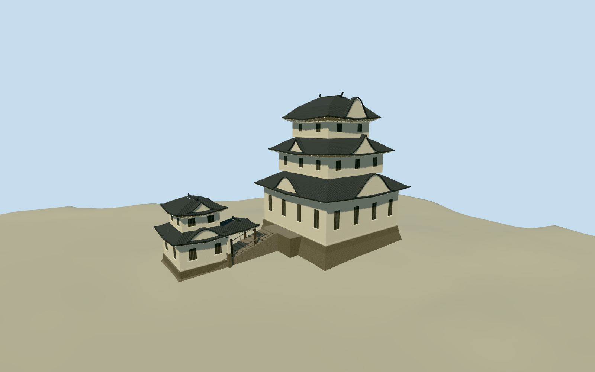

# Iga Ueno Castle

The rebuilt three-tier Iga Ueno main keep, its smaller companion and covered gate, with white plaster and upturned tile eaves.

Authoring state: **review-in-qa.json**. Current completion evidence is in [qa.json](qa.json) and the [completion ledger](../../../../qualla-structures/batches/qualla-004.PROGRESS.md).

- [Iga Ueno Castle: The White Phoenix Built on Ninja Ground](https://qualla.com/iga-ueno-castle/)

The placed model depicts the reconstructed pair of keeps and connecting entrance gate. The rest of the historic park, moat, ramparts and demolished premodern buildings are separate.

Historic stonework profile, small ornaments and precise window and roof tile details use medium-fidelity approximations.

Build: `node content/worldgen/source/places/xn/xn0/iga_ueno_castle/models/generate-iga-ueno-castle.mjs`. Add `--check` to verify exact regeneration. 7824 triangles; 5 materials; no embedded photographs.
