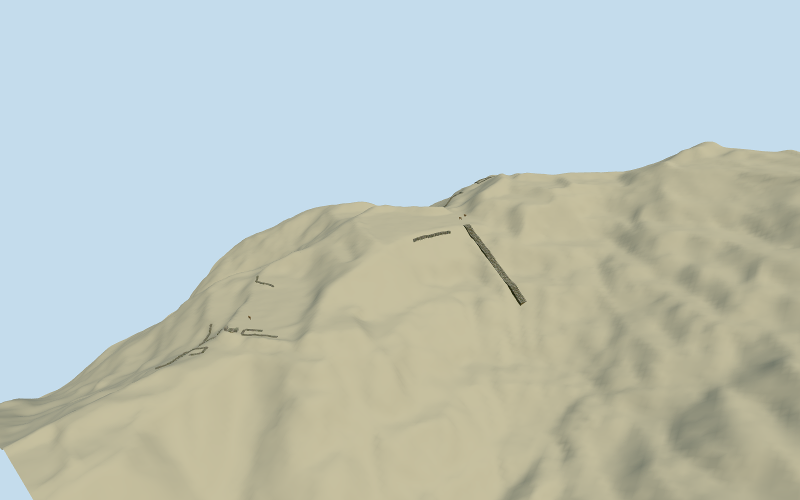

# Kannonji Castle

The weathered stairs, retaining walls and entrance masonry of the central Kannonji Castle ruins on their original hillside.

Authoring state: **review-in-qa.json**. Current completion evidence is in [qa.json](qa.json) and the [completion ledger](../../../../qualla-structures/batches/qualla-004.PROGRESS.md).

- [Kannonji Castle](https://qualla.com/kannonji-castle/)

Stone outlines and stairs follow the mapped routes through the retained historic site. Individual stones, the surviving masonry height where terrain is coarse, and exact ramp geometry between surveyed edges are estimates.

The model covers the surviving stonework in the central Honmaru and Hirai-maru area. The nearby Buddhist temple, outer enclosures and lost buildings are outside its scope.

Build: `node content/worldgen/source/places/xn/xn0/kannonji_castle/models/generate-kannonji-castle.mjs`. Add `--check` to verify exact regeneration. 14782 triangles; 3 materials; no embedded photographs.
