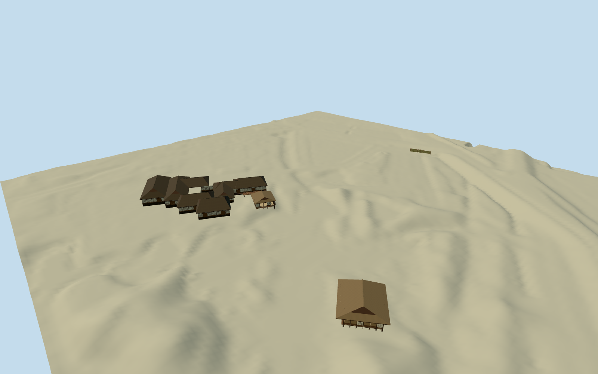

# Katsura Imperial Villa

Katsura Imperial Villa’s staggered Shoin residence, moon-viewing platform, open teahouses and bamboo front gate.

Authoring state: **review-in-qa.json**. Current completion evidence is in [qa.json](qa.json) and the [completion ledger](../../../../qualla-structures/batches/qualla-004.PROGRESS.md).

- [Katsura Imperial Villa: The Novel Made Real](https://qualla.com/katsura-imperial-villa/)

The main residence’s documented building sequence and overall perimeter are fixed. Exact internal roof junctions, heights, gate width and details away from the photographed views are estimates.

Only the main residence, Gepparō, Shōkintei and Omotemon are represented. Other tea houses, walls and garden structures are outside this model.

Build: `node content/worldgen/source/places/xn/xn0/katsura_imperial_villa/models/generate-katsura-imperial-villa.mjs`. Add `--check` to verify exact regeneration. 7252 triangles; 6 materials; no embedded photographs.
