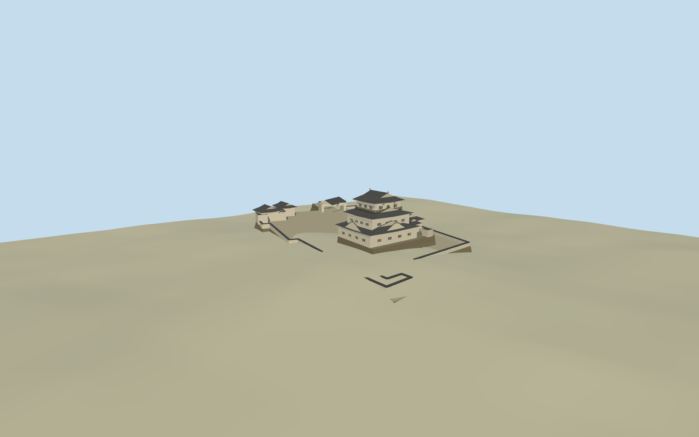

# Kishiwada Castle

Kishiwada’s three-tiered white keep and smaller companion above the stone moat-side terrace.

Authoring state: **review-in-qa.json**. Current completion evidence is in [qa.json](qa.json) and the [completion ledger](../../../../qualla-structures/batches/qualla-004.PROGRESS.md).

- [Kishiwada Castle: The Fortress That Hedged Its Bets](https://qualla.com/kishiwada-castle/)

The site plan follows the mapped castle structures and revetments. Fine ornamental carving and unpublished masonry heights are approximate.

The structure scope covers the inner castle, its surrounding retaining wall and attached gate buildings.

Build: `node content/worldgen/source/places/xn/xn0/kishiwada_castle/models/generate-kishiwada-castle.mjs`. Add `--check` to verify exact regeneration. 10395 triangles; 6 materials; no embedded photographs.
