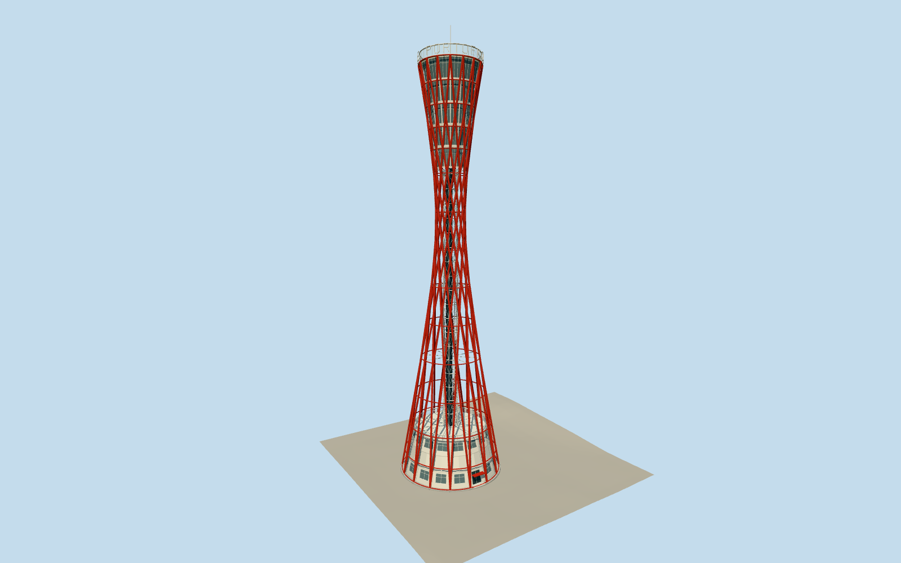

# Kobe Port Tower

Red32-straight-member hourglass lattice tower, open white central circulation cage, five flaring upper glazed floors, low white three-storey circular entrance base and2024 structural roof/low glass terraces. PORT OF KOBE lettering and lightning tip. Separate Kiss FM building, museum, waterfront fixtures and renovation wrap excluded.

Authoring state: **review-in-qa.json**. Current completion evidence is in [qa.json](qa.json) and the [local 100 ledger](../../../../qualla-structures/batches/PROGRESS.md).

- [The Red Drum Above the Harbor](https://qualla.com/kobe-port-tower/)

Primary25m/15m frame diameters,99.1m eaves,108m lightning tip and32 straight pipes guide scale/geometry. Cleared Qualla2019 CC0 original first, then three verified creator-CC0 waterfront2019/renovated2024/2025 originals control exterior comparison. Earlier CC/operator/aerial imagery is excluded. Temporary lighting/event artwork is not modeled.

Tube gauges, intermediate rings, cage bracing, window divisions, sign spacing, rooftop service return and entrance azimuth remain authored estimates; no construction survey. Interiors excluded apart from visible structural circulation cage. Transparent guard material is a bounded glass approximation.

Separate Kiss FM building, museum, pedestrian bridge, waterfront pavement/fixtures, tables/chairs/parasols and branding excluded. No photographic pixels redistributed. Independent native GSI5A ground preserved unchanged; own footing contact reviewed as a bounded preview. Other host terrain remains unverified; footprint replacement disabled.

Build: `node packages/worldgen/scripts/generate-authored-places.mjs --ids=kobe_port_tower`. Add `--check` to verify exact regeneration. 44660 triangles; 4 materials; no embedded photographs.
