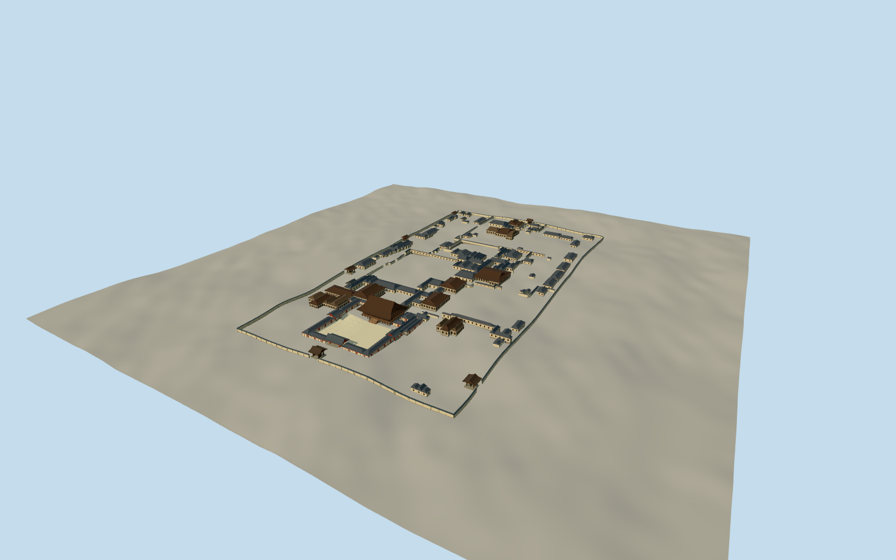

# Kyoto Imperial Palace

Kyoto Imperial Palace in April 2017, with Shishinden, Seiryoden, Kogosho and Otsunegoten, the connecting galleries, white-sand ceremonial court and the roofed gates set into the plaster perimeter.

Authoring state: **review-in-qa.json**. Current completion evidence is in [qa.json](qa.json) and the [completion ledger](../../../../qualla-structures/batches/qualla-003.PROGRESS.md).

- [Kyoto Imperial Palace](https://qualla.com/kyoto-imperial-palace/)

The model depicts the April 2017 exterior. The Shishinden roof width, depth and overall height come from palace records. Floor, skirt breaks and trim profiles were estimated against the cleared photographs.

The ground retains the original source field. Individual foundations, finished court grades, the gate thresholds and step assumptions are approximate.

The perimeter follows the mapped enclosure and its gate openings. Its post spacing and roof cross-section are approximate. Smaller mapped ancillary roofs in the palace have estimated roof divisions, materials and heights.

Rooms, furnishings, delicate carvings, gardens and vegetation are outside the exterior structure model. Distant detail levels simplify minor roofs and retain the distinct halls, gates and compound outline.

Build: `node content/worldgen/source/places/xn/xn0/kyoto_imperial_palace/models/generate-kyoto-imperial-palace.mjs`. Add `--check` to verify exact regeneration. 58830 triangles; 6 materials; no embedded photographs.
