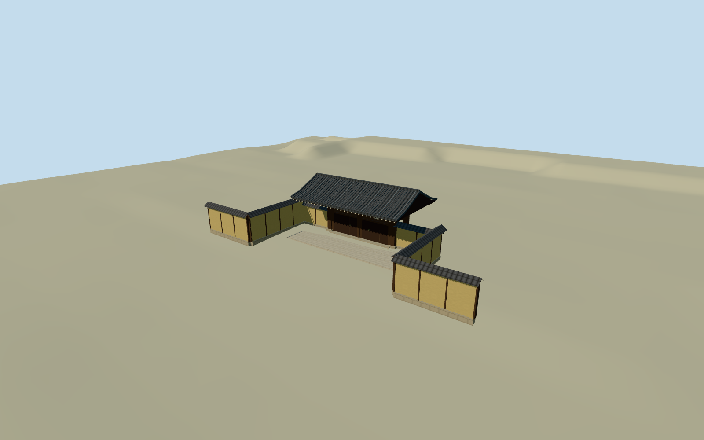

# Kyoto State Guest House Main Gate

Kyoto’s formal west-facing guesthouse gate with slate-gray tile, timber lattice doors and short plaster wings.

Authoring state: **review-in-qa.json**. Current completion evidence is in [qa.json](qa.json) and the [completion ledger](../../../../qualla-structures/batches/qualla-004.PROGRESS.md).

- [Kyoto State Guest House](https://qualla.com/kyoto-state-guest-house/)

Represents the formal outer view of the publicly photographed gate and its immediate plaster wings. The rest of the guesthouse precinct and interiors are outside model scope.

Rafter profile, rear joinery, wall apron courses and measured heights are representative estimates.

Build: `node content/worldgen/source/places/xn/xn0/kyoto_state_guest_house_main_gate/models/generate-kyoto-state-guest-house-main-gate.mjs`. Add `--check` to verify exact regeneration. 6182 triangles; 6 materials; no embedded photographs.
