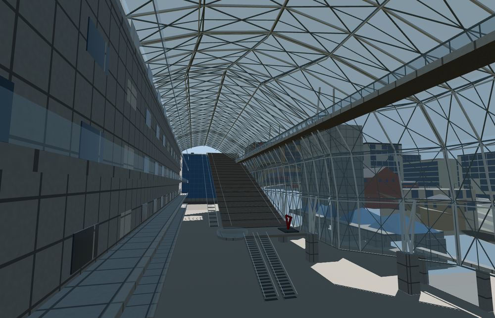

# Kyōto Station

The Isetan and Granvia wings flank an open atrium under a curved steel and glass canopy. The Grand Staircase rises 35 metres to the west terrace, with a suspended Skyway and tiered galleries above the entrance hall. The Hachijō frontage encloses the raised Shinkansen decks and connects to the mapped platform sheds.

The 49,869-triangle source rebuilds byte for byte. Skyline, district, street and close-up use 996, 3,997, 15,949, 43,415 triangles. Skyline and district total 447,204 bytes. Six GLBs validated and 38 current views were inspected.

The model replaces 18 mapped station parts and preserves 567 surrounding buildings and 518 transportation records. All four tiers pass checks for six open doorway samples, six staircase levels, four Skyway floor samples, four canopy crests, eleven rail passages and four surrounding terrain samples. Ground, water and landcover restore on unload.

The podium, outer building wings, rail centerlines and platform shelter footprints follow PMTiles. Photo interpretation supplies the atrium section, public circulation and individual facade bays. The forecourt elevations follow open Terrarium approach samples. The station floors and railway deck elevations are reconstructed to bridge high samples over the built site. The model represents the exterior, the public atrium and the above-ground track concourses. Stairs, escalators and railway fixtures are static geometry.

Rebuild with `node packages/worldgen/scripts/generate-kyoto-station.mjs`. Append `--check` to compare exact bytes. Use `--ids=kyoto_station` for targeted import, LOD, placement and readiness.
