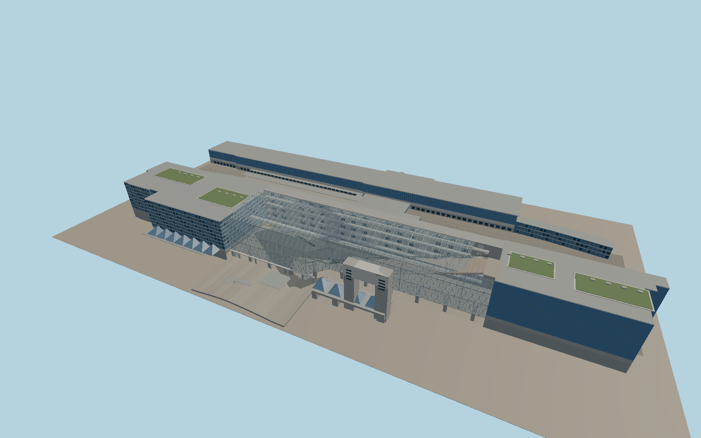

# Kyōto Station

The Isetan and Granvia wings flank an open atrium under a curved steel and glass canopy. The Grand Staircase rises 35 metres to the west terrace, with a suspended Skyway and tiered galleries above the entrance hall. The Hachijō frontage encloses the raised Shinkansen decks and connects to the mapped platform sheds.

Run `node packages/worldgen/scripts/generate-kyoto-station.mjs` to rebuild the source master. Append `--check` to compare the exact bytes. Use `--ids=kyoto_station` for targeted import, LOD generation and placement.

The podium, outer building wings, rail centerlines and platform shelter footprints follow PMTiles. Photo interpretation supplies the atrium section, public circulation and individual facade bays.

The forecourt elevations follow open Terrarium approach samples. The station floors and railway deck elevations are reconstructed to bridge high samples over the built site.

The model represents the exterior, the public atrium and the above-ground track concourses. Stairs, escalators and railway fixtures are static geometry.

Original geometry follows the repository license. Map data is © OpenStreetMap contributors under ODbL-1.0 via Protomaps. Terrain samples are described in terrain-grid.json. Local photographs serve as visual references for the authored geometry. Current acceptance is recorded in qa.json.
