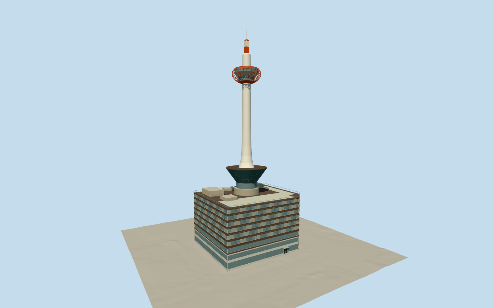

# Kyoto Tower

Smooth white candle/lighthouse shell with orange-red two-tier glazed observation cage, white upper service drum and flat-faced banded antenna, inverted dark lower bowl, actual nine-storey hotel/commercial podium with light lower frontage, dark upper bands, southeast chamfer, window belts and own roof/service blocks. Neighbor buildings and Kyoto Station fixtures excluded.

Authoring state: **review-in-qa.json**. Current completion evidence is in [qa.json](qa.json) and the [local 100 ledger](../../../../qualla-structures/batches/PROGRESS.md).

- [Kyoto Tower](https://qualla.com/kyoto-tower/)

Started with two cleared published Qualla2011 creator-CC0 originals; independently verified creator-CC0 Brakeet2019 tower/hotel and Mr.ちゅらさん2024 exterior photographs fill missing coverage. Earlier attribution-licensed and aerial imagery are excluded from current approval. White shaft remains white; temporary coloured lighting is not baked into materials. Own supporting hotel/commercial podium included; separate buildings, station canopies/trees/signs and interiors excluded. No photographic pixels redistributed.

Mapped30.8m podium and height-coded tower parts plus primary131m total/100m observation guide vertical hierarchy. Smooth shaft profile, cage-rib count/gauges, window divisions, rear facades, roof/mechanical details and entrance positions remain original medium-fi estimates, not surveyed construction geometry. Small signs/branding and roof furniture omitted.

Independent original GSI1A terrain retained unchanged with all16641 valid source samples. Own foundation/south entrance contact reviewed as a bounded preview; other host terrain remains unverified and footprint replacement disabled.

Build: `node packages/worldgen/scripts/generate-authored-places.mjs --ids=kyoto_tower`. Add `--check` to verify exact regeneration. 47158 triangles; 4 materials; no embedded photographs.
