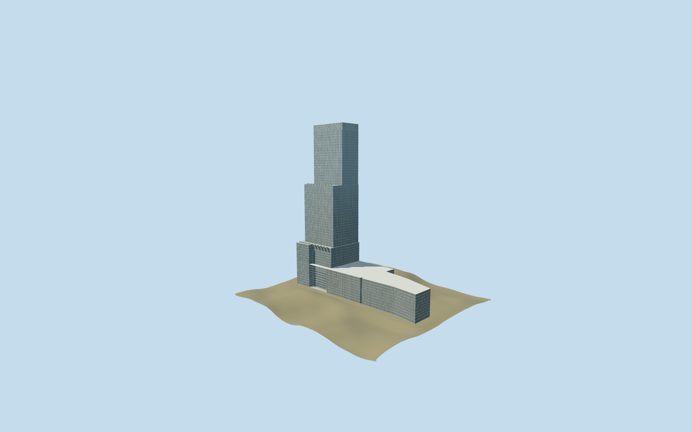

# Abeno Harukas

Abeno Harukas compact exterior preserves the western Tower-Kan perimeter, three stepped glass stages, the full mapped station/mall podium and an open sky court inside the observation gallery. Detailed original master independently preserved.

## Evidence and reconstruction

Published dimensions and reconstructed details are separated in spec.json. Primary references:

- [Reference](https://www.abenoharukas-300.jp/en/)
- [Reference](https://www.takenaka.co.jp/takenaka_e/abeno/design/de-04.html)
- [Reference](https://www.takenaka.co.jp/takenaka_e/abeno/h300/h300-02.html)
- [Reference](https://www.jisf.or.jp/en/activity/sctt/documents/SCTT38.pdf)
- [Reference](https://www.abenoharukas-300.jp/en/observatory/guide.html)
- [Reference](https://www.openstreetmap.org/way/488467176)

No third-party geometry, photograph or bitmap texture is embedded. Shared surface graphs come from the central library; vertex tints carry model colors. Glazing uses PBR materials; transparent surfaces are declared per model.

## Model and axes

22,049 triangles; 66,147 vertices; 4 material groups; 2,648,688 bytes. Native bounds: -137.561, 0.000, -44.068 to 137.561, 300.000, 44.068. Source hash: `sha256:4f3463d01ac625a7e246cc6e1f0ba7ce7d3cec3581223563f53cf9a04f039011`.

{"up":"+Y","longitudinal":"+X along the mapped building long axis","front":"+Z","origin":"Center of whole mapped podium ground datum; main tower is at nativeX about -89 m"}

Two inspected exterior pictures show the western offset tower, three stepped glass stages, broad station podium and rooftop gallery. Preserve the original 300m height, mapped 274.821×87.837m podium and separate Tower-Kan perimeter. PMTiles confirms the station/mall location and surrounding roads; native +X follows the long station axis and the tower stays around nativeX−89m. Upper stages and sky court retain the original exterior reconstruction. Off-podium PMTiles point[0,80]25.2447m sets approximate ground contact; center37.7806m has coarse urban roof imprint. Bounded rectangular preview contacts cover the entire podium and retain raw samples separately. Exact fins, planting, service equipment, station thresholds and gallery court dimensions remain approximate.

## Reproduce

Run `node packages/worldgen/scripts/generate-signature-towers.mjs --ids=N0139` (or add `--check`). The generator preserves manually edited masters by checking their baseline hashes. Import through the standard authored-model workflow with optimization disabled; then capture all QA cameras, including shared-surface views.

## Pending work

- Two inspected exterior pictures show the western offset tower, three stepped glass stages, broad station podium and rooftop gallery. Preserve the original 300m height, mapped 274.821×87.837m podium and separate Tower-Kan perimeter. PMTiles confirms the station/mall location and surrounding roads; native +X follows the long station axis and the tower stays around nativeX−89m. Upper stages and sky court retain the original exterior reconstruction. Off-podium PMTiles point[0,80]25.2447m sets approximate ground contact; center37.7806m has coarse urban roof imprint. Bounded rectangular preview contacts cover the entire podium and retain raw samples separately. Exact fins, planting, service equipment, station thresholds and gallery court dimensions remain approximate.
- Three canonical granite/concrete/painted-metal graphs reused; glass uses opaque PBR parameters without copied textures. Low tiers merge facade bays and omit fins, railings and service equipment. Street preserves the gallery bracing and fins; closeup adds terrace planting and podium equipment. Physical-device timings unmeasured.

This bundle follows the medium-fi standard. Medium-fi appearance and geographic fit are reviewed separately. Hash-bound visual acceptance is recorded separately after capture inspection.
