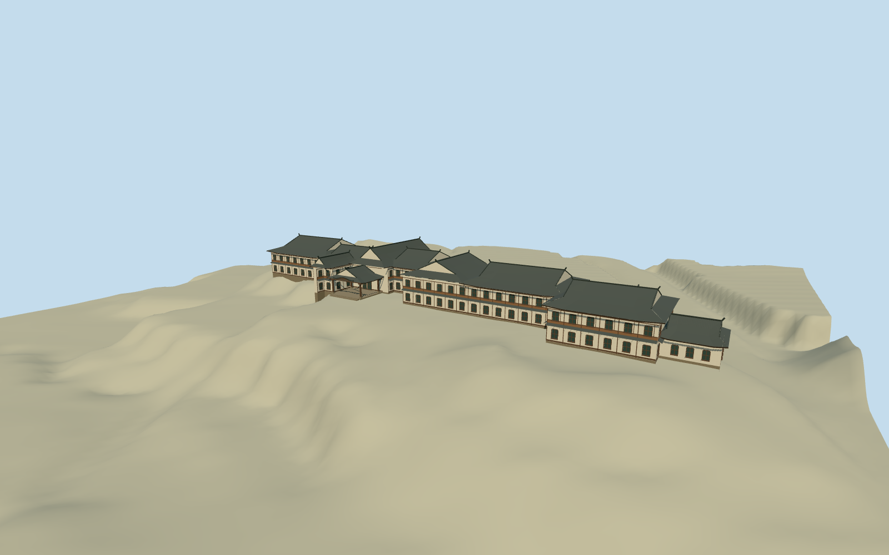

# Nara Hotel Main Building

The 1909 timber hotel with a carriage porch and staggered, tiled wings on the crest of Daijoin Garden.

Authoring state: **review-in-qa.json**. Current completion evidence is in [qa.json](qa.json) and the [completion ledger](../../../../qualla-structures/batches/qualla-004.PROGRESS.md).

- [Nara Hotel: The Guestbook That Reads Like a History of the Twentieth Century](https://qualla.com/nara-hotel/)

The model covers the 1909 main building. The 1984 west addition and landscape structures are outside the placement scope. The seam at the newer wing and individual roof junctions are approximate.

The public-domain side sources establish the timber grids and rooflines. Window allocations on less visible faces, elevations and minor ridge ornaments are representative.

Build: `node content/worldgen/source/places/xn/xn0/nara_hotel_main_building/models/generate-nara-hotel-main-building.mjs`. Add `--check` to verify exact regeneration. 18300 triangles; 5 materials; no embedded photographs.
