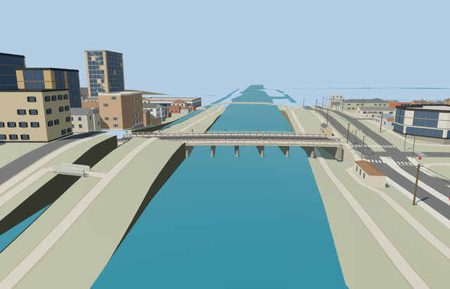

# Sanjō Ōhashi Bridge — current medium-fi pass

Reviewed2026-10-25. **Scoped bridge exterior and approximate native placement complete.**

## Geometry and shared materials

Inspected74 current frames:14 preserved-master,14 shared-material placement,30 medium-fi and16 native. Nine cambered spans, eight seven-column pier frames and circular stone shoes, fourteen green bronze giboshi, pale hinoki rails, open asanoha barriers, fine gray checker walks and steel soffit remain complete. Browser curbs now rise30cm and intermediate post clamps use the existing green bronze surface. The detailed716504-triangle source and canonical master retain their exact earlier bytes and18cm/dark-clamp interpretation.

Six existing shared graphs on the detailed master; seven central256px graphs on textured browser levels, including reusable alpha asanoha and fine checker paving. Each graph reads once; no embedded image, private atlas or redistributed photo. Skyline is one mean-color draw; nearer levels use eight draws. Metric UVs and separated GPU vertex streams pass.

| Level | Triangles | Bytes | Draws |
| --- | ---: | ---: | ---: |
| skyline | 994 | 78948 | 1 |
| district | 3996 | 314696 | 8 |
| street | 15704 | 1170348 | 8 |
| closeup | 28920 | 2108496 | 8 |

Four browser levels:994/3996/15704/28920 triangles and78948/314696/1170348/2108496 bytes. Initial skyline plus district is393644 bytes; the detailed58.6MB master is not the initial browser download. Near models retain all56 columns; skyline retains the complete crossing/pier-row/finial silhouette with reduced inner supports. Physical ordinary-laptop and phone/tablet measurements remain pending.

## Native fit

Retained exact-QID anchor[135.771720333,35.009046048], heading0.123568417936rad: +X east-northeast to Higashiyama, +Z downstream/south. Authored73.3x16.7m section retained. Standard PMTiles/Mapzen gives local native water42.150093m; provisional model base41.70m submerges shoes about0.45m and contacts the lower east dry bank. Both native road-end joins meet the46.25m authored deck within0.01m. The rejected west-bank DSM reference had left footings2.33m above water. Bounded bridge/immediate-approach terrain caps at sourceY0.45m remove coarse high banks without changing raw DEM or water; lower banks and approach paving remain. An inset bridge-interior paving mask grades the original river walk beneath the deck while retaining its mapped route; paving beyond the bridge can still overstate bank heights. The cap, river level and steep outer bank transitions are approximate visualization, not surveyed foundations or riverbed.

All 512 resident / 1988 wider native buildings and 1211 independent road records remain. Original road inputs, raw heightfield samples, native water and outside-ground probes remain exact. Only mapped bridge strips/direct approaches receive road replacement/height hints. Failure keeps native geometry and creates no supports; unload restores bank/ground geometry and disposes every model/support resource. Coarse paving outside the inset mask remains elevated in some close backgrounds; native detail cameras are placed clear of bank surfaces and pier columns; their source-local counterparts remain unchanged.27 terrain and57 Earth tests, both package typechecks,5 Sanjo LOD tests and changed-file Biome checks pass. Earlier full-repository livery-schema failures remain separately recorded.

## Verification

Selected source reproducibility, strict medium-fi, scene validation and30-tick simulation pass. Six GLBs/580 geometry probes and74 inspected current frames bind the current source/runtime/LOD/placement/fixture hashes. Tests use a workspace-local temporary directory because Windows sandbox temp virtualization caused Vitest ENOENT errors; all targeted suites pass with that corrected test environment. Bulk captures stay ignored; two small previews stay with source.

## Pictures and limits

Ordinary restored-bridge photographs from [the railing maker](https://note.sekisuijushi.co.jp/n/n6ac7ea5a0500) and the retained March2025 Kyoto photo collage informed the curb/clamp corrections. No photo pixels are redistributed. See reference-metadata.json and map-frame.json. Native map attribution: © OpenStreetMap contributors, ODbL-1.0. Detailed historic inscriptions, statues, vehicles, surrounding unique architecture and surveyed foundations are outside this asset. The original master retains its historical curb/clamp interpretation; current browser models carry the visible corrections.
