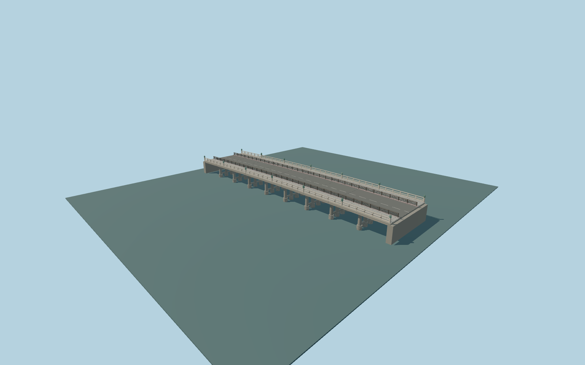

# Sanjō Ōhashi Bridge

Present steel nine-span bridge with the completed2024 hinoki railings, fourteen retained bronze giboshi, timber girder covers, circular stone shoes and multi-column frames, renewed silver-gray checker paving and modeled asanoha-pattern pedestrian barriers.

## Evidence

- [Primary reference](https://www.hido.or.jp/wp-content/uploads/2024/10/2410chiiki-kyoto_city.pdf)
- [Primary reference](https://www.city.kyoto.lg.jp/kensetu/cmsfiles/contents/0000149/149842/hashishirube22.pdf)
- [Primary reference](https://www.city.kyoto.lg.jp/kensetu/cmsfiles/contents/0000149/149842/hashishirube15.pdf)
- [Primary reference](https://www.openstreetmap.org/way/571549175)
- [Primary reference](https://maps.gsi.go.jp/development/hyokochi.html)
- [Primary reference](https://maps.gsi.go.jp/development/demtile.html)

Published dimensions and reconstruction assumptions are separated in spec.json. Source photos were consulted; no photos or third-party geometry are embedded. Map plan attribution: © OpenStreetMap contributors, ODbL-1.0.

## Source

716504 triangles; 58571200 bytes; 8 material groups. SHA256: sha256:b55904e710bd425358986f38bd7768c97a1e090de42b83f03fe266cb97154f25.

Shared surfaces (stone_granite, concrete_plain, metal_painted, wood_plain, metal_bronze_cast, metal_stainless) are loaded through the central library; any transparent materials use local PBR parameters. Axis and provisional vertical datum are in spec.json.

Regenerate with node packages/worldgen/scripts/generate-researched-bridges.mjs --ids=sanjo_ohashi_bridge; append --check to verify. Import and capture through the standard structure-catalog scripts. Geometry validation does not substitute for current-frame visual review.

## Reconstruction limits

- Fine historic finial inscriptions and individual sword scars require additional close photographic evidence.
- Adjacent statues, street signs, temporary furniture and vegetation are outside this bridge asset.
- The original detailed master retains its earlier18cm curb/dark-clamp interpretation. Current browser levels correct the visible curb to30cm and near post clamps to patinated bronze; the original detailed source recipe/bytes remain preserved.
- Ordinary photographs and standard PMTiles/Mapzen guide this current review. The retained GSI study is historical evidence and is not fetched or required for normal builds or the current placement fixture.
- Near river stage and bank/road widths remain generalized; source pier proportions and seven-column schedule are retained without a new fabrication survey. Physical laptop/phone timings remain pending.
- Footing placement uses a provisional local water fit, not surveyed foundation levels. Coarse terrain beside the bounded bridge/approach openings can remain steep, and distant road grades are generalized. No native water or terrain samples are changed.
- A bounded native-terrain cap at sourceY0.45m reconstructs dry banks beneath the bridge/immediate approaches where coarse DSM is too high. Native heightfield samples and water remain exact; the cap and steep outer bank transitions are visualization approximations.
- Intersecting native river-walk paving receives a bounded underpass grade at the same bank cap inside the inset bridge footprint. Its original route remains; exact ramps and historical riverside steps are not reconstructed.
