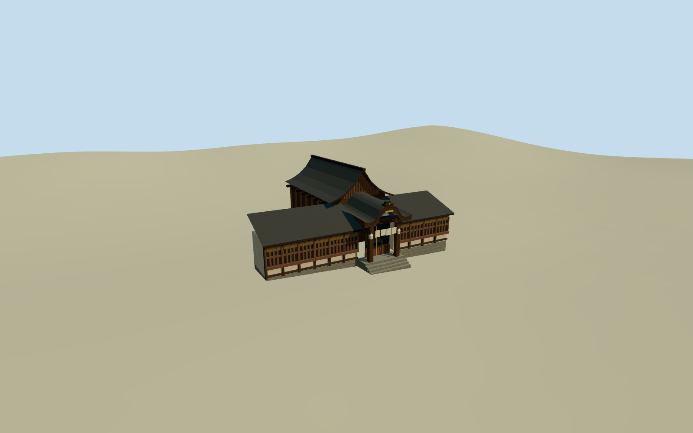

# Seimei Shrine

Seimei Shrine’s main sanctuary in Kyoto, with its raised timber interior, undulating karahafu canopy, stone entrance steps and narrow lower wings.

Authoring state: **review-in-qa.json**. Current completion evidence is in [qa.json](qa.json) and the [completion ledger](../../../../qualla-structures/batches/qualla-004.PROGRESS.md).

- [Seimei Shrine: Kyoto's Portal to the Spirit World](https://qualla.com/seimei-shrine/)

Exterior of the main shrine and attached worship frontage only. The separately mapped torii, auxiliary shrines, gift office, precinct sculptures and interiors remain outside the asset.

The combined building footprint and steps establish the model plan and facing. Heights, roof transition and smaller woodwork are visually estimated from the cleared front views.

Build: `node content/worldgen/source/places/xn/xn0/seimei_shrine/models/generate-seimei-shrine.mjs`. Add `--check` to verify exact regeneration. 3382 triangles; 6 materials; no embedded photographs.
