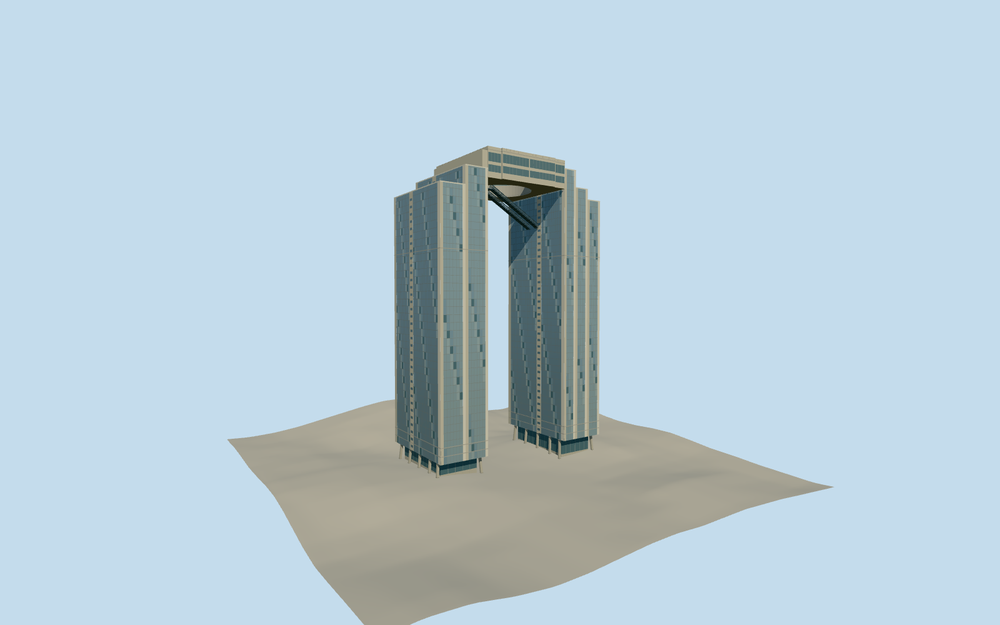

# Umeda Sky Building

Osaka’s 173-metre twin towers with their open circular Floating Garden Observatory and paired inclined escalators.

Authoring state: **review-in-qa.json**. Current completion evidence is in [qa.json](qa.json) and the [completion ledger](../../../../qualla-structures/batches/qualla-003.PROGRESS.md).

- [Umeda Sky Building](https://qualla.com/umeda-sky-building/)

The mapped tower parts and roof aperture control plan geometry. The 173 m height and escalator span come from the owner. Heights of individual terrace levels, curtain wall modules and supporting details are estimates.

The 2007 photograph supplies the view through the permanent crown and escalator arrangement. The two April 2011 photos guide cladding and lower supports. Temporary access rigs and neighboring development are outside the model scope.

The source terrain is unchanged and the plaza connections are approximate.

Build: `node content/worldgen/source/places/xn/xn0/umeda_sky_building/models/generate-umeda-sky-building.mjs`. Add `--check` to verify exact regeneration. 11776 triangles; 7 materials; no embedded photographs.
