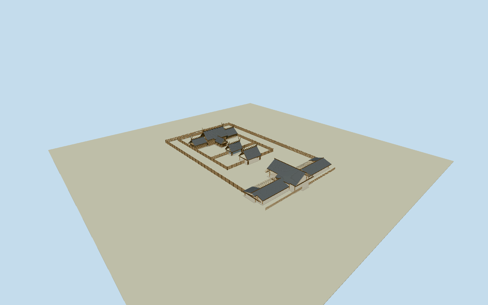

# Atsuta Shrine

Whole principal Hongu sanctuary ensemble: all16 vertices of main building57008547, both separate6-point inner gate roofs57008548/57008551 and whole24-point outer worship hall373238591. Preserve the main building, flanking low sections and south spur, two inner roofed gates and full outer hall/wings with open passages. Original four wood-palisade traces remain thin intrinsic architectural fences with their native gaps. Steep copper-gray Shinmei gables, exposed wood posts/boards/brackets, projecting ridge ends, forked chigi and cylindrical gold-ended katsuogi. Exclude the separate Kagura-den, Doyoden, treasure hall, other shrines, whole wooded religious parcel, natural ground/trees/people/flags/signs/crest art/sacred interiors. Keep all16/6/6/24 original physical plan vertices; retain native gaps/open yards and thin fence traces, no whole precinct or courtyard slab. Original main16 partitions: central taller steep gable, two flanking lower sections and south spur; exact partitions/heights bounded. Inner gates are distinct steep gables with genuine open passages under the roof, not opaque box doors covering the whole opening. Outer24 worshiphall has complete wings and projecting central roof/passage, bounded hidden front details. Use muted dark copper roof/layered fascia, warm weathered unpainted timber boards/round posts/trusses/visible gable overhang/ridge/paired forked chigi/cylindrical katsuogi with small gold ends. Fence rows coarsen at distance while retaining native trace/gaps. Do not copy Kamon/letters or infer main architecture from published Kagura/Doyoden images. Freeze independent384m129x129field at fixed south approach before geometry; no flatten/fitting/reacquisition, actual forest/urban approach contact unverified.

Authoring state: **review-in-qa.json**. Current completion evidence is in [qa.json](qa.json) and the [completion ledger](../../../../qualla-structures/batches/qualla-002.PROGRESS.md).

- [Atsuta Shrine](https://qualla.com/atsuta-shrine/)

Four distinct original physical plans: main Hongu buildingway57008547/all16 vertices, middle inner roofway57008548/all6, front inner roofway57008551/all6 and outer worshiphallway373238591/all24. Four wood-fence traces57016851/53/54/55 retain all original points and open ends. Mean original16-point main building anchor and native edge7to8 east-axis fixed before terrain and geometry. Native religious landuse relation8453890/Q482065 is identity only, never a building envelope. Main16-point roof partitions and all heights/roof profiles/facade detail are bounded original photographic interpretations; native outlines do not supply an engineering roof/height survey.

Whole main16-point sanctuary/two6-point inner gates/24-point outer worshiphall and all4original open palisade traces retained. No whole religious parcel/yard/natural-ground slab. Precise roof subdivisions and main10.2m/flank6.7m/middle7.2m/front8.4m/worship9.5m ridges, chigi tips, wall/platform/fence/section dimensions and current patina are bounded photo estimates, not native engineering measurements.

Qualla-first51families/zero conflicts. Two exact creator-CC0 published originals inspected but unused: named Kagura-den and Doyoden are separate buildings. One supplemental exact4804x2830SaigenJiro main Hongu original inspected, own-work self-CC0 grant/nativeSHA1/revision bound; unchanged inventory policy passed. No attribution-only pixels, official map/photos, postcard reconstruction or media-metadata/policy changes.

Steep dark copper-gray gables, wood post/panel/eave/gable framing, projecting ridges/paired chigi/cylindrical gold-ended katsuogi, open inner gate passages/complete worship wings/thin wood palisades. Native outer worshiphall front/rear and exact roof split/fence/ornament census are bounded; near detail coarsens at distance. Plain doors/metal fittings omit crests/letters and sacred interior contents. Separate Kagura-den/Doyoden/other shrines/treasure hall/park/trees/people/torii elsewhere excluded.

Independent384m129x129field/all16641values/two raw Terrarium tiles frozen before geometry unchanged without fit/flatten/reacquisition.15.3161m provider-relative south approach and0.2277..23.1913m absolute field are not surveyed building/forest/street grades. Native placement is preview/replaceFootprint=false; actual host contact unverified. Portable/shared/context flat fixtures separate.

Build: `node packages/worldgen/scripts/generate-authored-places.mjs --ids=atsuta_shrine`. Add `--check` to verify exact regeneration. 45430 triangles; 5 materials; no embedded photographs.
