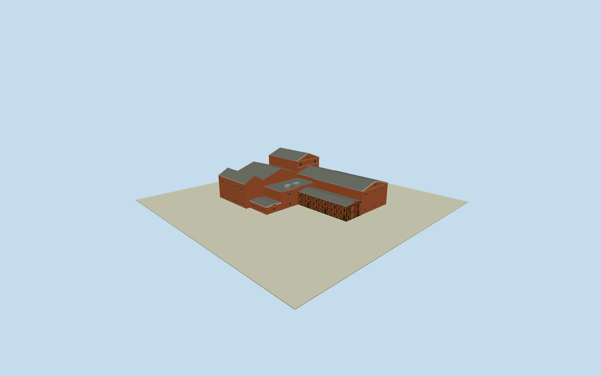

# Handa Red Brick Building

Whole surviving HandaRedBrickBuilding/Q11407095 connected heritagegroup: native12control stepped outerenvelope, redbrick main industrialbuilding with highgable tower/broad lowergable and narrow sidegable, flatroofstorage, two-storey half-timbered redbrick wing/darkXbraces/shallow grayroof/door and smallpaned window ranks, intrinsic low attachedshop; blindarchedpanels and circulargablevents/pale keystones/coping/bands/brickpilasters and corbelledgable. Exactcomponentpartitions/sections/hiddenfaces/windowcensus original bounded estimates. Exclude separate2022KabutoBeertower, demolishedhistoricfactorywings, neighborhood, museuminteriors/displays/people/landscape/signage/text.

Authoring state: **review-in-qa.json**. Current completion evidence is in [qa.json](qa.json) and the [completion ledger](../../../../qualla-structures/batches/qualla-002.PROGRESS.md).

- [Handa Red Brick Building](https://qualla.com/handa-red-brick-building/)

Actual HandaRedBrickBuilding/Q11407095/nativeway627492620: all12 unique connected perimeter controls. Mainbuilding/storage/halftimberedwing modeled together as one connected heritagegroup. Native map establishes whole outergroup, not internal volume boundaries; original bounded component subdivisions/roof sections from three exactQualla exteriororiginals. Fixed native bboxmidpoint/+Xeast/+Zsouth/heading0. No neighboringbuilding, modern2022advertisingtower or demolishedfactorywing substitution.

Independent400m129x129/16641samples/one originalrawtile frozen before allfloors/sections/geometry. Flat structuralfloor0 relativefixed9m provider datum unsurveyed; no heightfit. Original bounded interpretation of whole native12control steppedgroup: north west/central/east gabledbrickmasses (12.5/16.2/21.8m maximum), lower flatstorage9.2m, southern highbrickwing14.3m and two-storey half-timbered wing8m. Photos establish material/form/relativeheight vocabulary; componentboundary stations -16/7/6m andzbandbreaks, roofbearings, exacthiddenwalls/windowcensus/plantlayout are original mediumfi estimates, not a measured internalplan. Preserve entire nativewholegroup, no facade-only replacement or advertisingtower. Recesses.22m; darkXbraces/frame/bands/palegablecopings/stonekeystones and bounded vents/roofplant. Precisefooting/threshold/hostcontact unresolved, geographicpreview/replaceFootprintfalse; immutablefield/no siteplate. Low intrinsic west attachedshop3.7m eaves/4.25m ridge, bounded originalestimate; lowerhalftimberrank includes glazed entrydoors.

Whole surviving connected heritagegroup retained: all12 nativeoutercontrols, mainredbrick gabledmasses/flatstorage/half-timbered wing, darkwoodXbraces/two windowranks, arched and blindbrickpanels, small circularvents/palekeystones/copings/bands and bounded roofplant. Separate2022replicaadvertisingtower/demolishedfactorywings/museuminteriors/display/people/neighbors/landscape/signage excluded.

Three exactpublishedQualla Own/selfCC0 exteriororiginals individuallyinspected/nativeSHA1matched. Hero/otherinteriorreferences unselected; no protected or questionable pixels/sourcebody/media/metadata repair, no supplementalphotos or phototextures. Componentboundaries/roofbearings/heights/hiddenwalls/windowcensus/plantlayout are original bounded mediumfi estimates rather than a surveyed brewery plan.

Independent400m129x129 field/16641samples/one originalrawtile frozen before allfloor/section/geometry choices. Flat referencefloor0 relative9m provider datum unsurveyed. Originalgrid/PNG/rawtile immutable; precisefooting/threshold/gradecontact unresolved, geographicpreview/replaceFootprintfalse. No fittedground or modeled siteplate.

Build: `node packages/worldgen/scripts/generate-authored-places.mjs --ids=handa_red_brick_building`. Add `--check` to verify exact regeneration. 12466 triangles; 6 materials; no embedded photographs.
