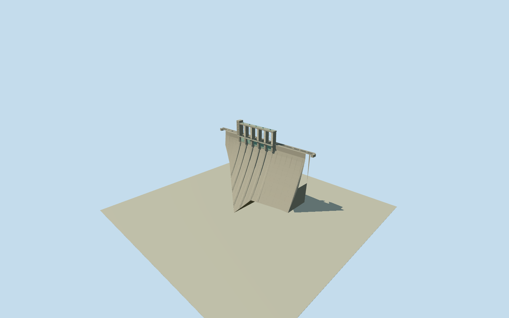

# Sakuma Dam

Complete native Sakuma concrete gravity dam with original nine-vertex irregular body/toe plan and four-point crest crossing, five genuine lowered spillway slots/closed mint roller gates, six-pier open operating frame/enclosed northwest tower, tall downstream chute ribs, steep nonoverflow flanks, concrete lift/expansion seams, crest asphalt/sidewalks/solid parapets and bounded catwalk/hoist details. Crest/foundation section and hidden upstream/host contact are explicit photographic estimates; no gorge/river/reservoir or separate converter/power facilities.

Authoring state: **review-in-qa.json**. Current completion evidence is in [qa.json](qa.json) and the [completion ledger](../../../../qualla-structures/batches/qualla-002.PROGRESS.md).

- [Sakuma Dam](https://qualla.com/sakuma-dam/)

Original named SakumaDamway1289135788/Q1141896supplies all9native polygon vertices, including irregular downstream toe/end offsets. Native bridge/crest-roadway262530111supplies all4crossing vertices and signed northwest/southeast chord; these are separate controls. The mapped visible body/crest crossing is shorter than operator293.5mfull engineering crest; do not stretch native geometry or invent buried abutment extensions. Operator155.5mmaximum foundation height is a bound on the inferred gravity section, not a claim that every visible flank is155.5mtall. Five gate count is operator-confirmed and visible in exact cleared2008QuallaPDfront. Hidden upstream/foundation/sections and precise gorge/host contact remain estimates.

Raw Terrarium tiles contain implausible below-sea-level inland samples, including native-footprint relative minimum about-1655m at crest-reference281.8262m. Original bytes/grid are retained as diagnostic source evidence only; these anomalies do not control geometry, section height or acceptance of actual gorge/footing contact. Geographic shared review uses a flat inspection stage; precise terrain contact is unverified.

The native four-point crest crossing is270.73m; all nine body polygon controls are preserved independently. Operator293.5mfull engineering crest includes abutment extent not established by this visible body/crossing. Do not stretch mapping to that scalar. Maximum155.5mheight bounds an original tapered width-dependent gravity-section estimate, not a survey or a claim that every exposed flank is that height. Exact buried core/foundation, upstream slope, crossfall, abutment profiles and host-gorge/toe/threshold contact remain unverified.

Two exact3072x2304published Qualla photographs by河川一等兵were inspected first, with local SHA1matching original native Commons pages and explicit same-authorPD-userdedications. Main downstream face and crest road/tower side guide the model. Sakumadosuiro is a separately identified Toyogawa diversion, not the main dam; it and FDC/separate power stations, historical construction/portrait and other licensed photographs are unused. J-POWERoperator text supplies height/engineering length/five-gate count only; no operator image or photographic texture used.

Five lowered full-width spillway slots/closed roller-gate panels, six-pier operating frame, enclosed northwest tower, mint steel stiffeners/hoist rails and downstream chute ribs retain the defining exterior. Gate/pier pitch/width, tower/frame heights, ogee/section curves, rib thickness, machinery/wire placement and exact weathering are medium-fi photographic estimates. Two operator-listed low-level discharge assemblies have concealed routing/exact openings unsupported by selected exterior; no invented exposed holes. Tower lettering/logo and fine bolts/tile/stain patterns are not reproduced exactly.

Only intrinsic dam body/crest crossing, maintenance catwalks/rails and bounded near-end support blocks are included. Separate converter/power station, visitor museum, Toyogawa diversion, adjacent bridges/road tunnels, planters/people/forest, reservoir/water/riverbank/gorge landscape are excluded. Original DEM is preserved with a fixed northwest crest approach; portable ground below foundation is an inspection stage, not a surveyed riverbed.

Build: `node packages/worldgen/scripts/generate-authored-places.mjs --ids=sakuma_dam`. Add `--check` to verify exact regeneration. 9770 triangles; 2 materials; no embedded photographs.
