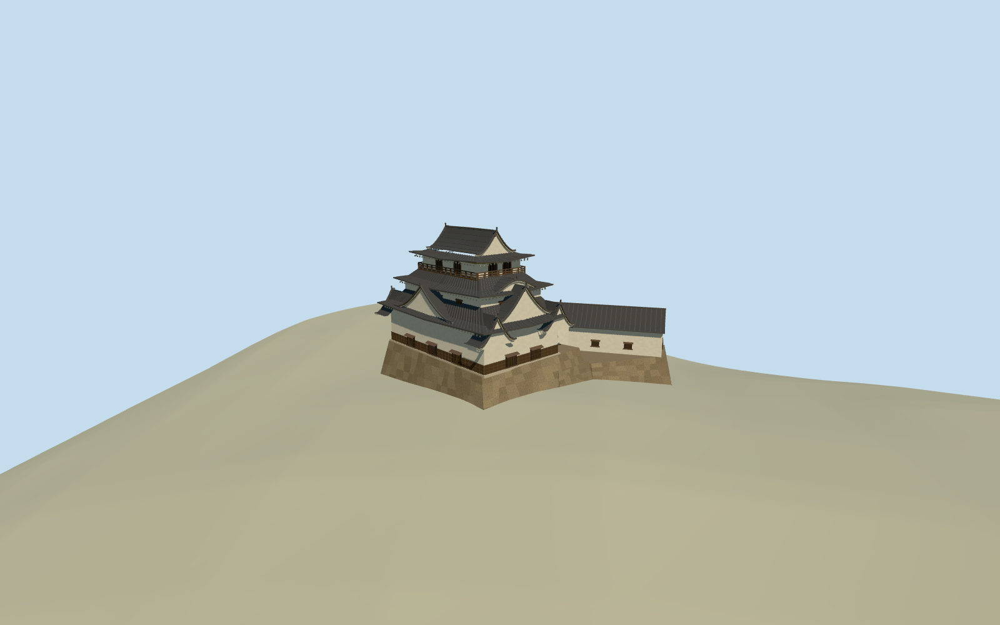

# Hikone Castle

The hilltop Hikone Castle keep and connected turrets, with three tiers of curved tile roofs, white gables, timber skirting and battered stone.

Authoring state: **review-in-qa.json**. Current completion evidence is in [qa.json](qa.json) and the [completion ledger](../../../../qualla-structures/batches/qualla-004.PROGRESS.md).

- [Hikone Castle: The Fortress an Emperor Refused to Destroy](https://qualla.com/hikone-castle/)

Roof crests, the stone courses and smaller windows are approximated. The separated moat and far gates and turrets are outside the main keep grouping.

Build: `node content/worldgen/source/places/xn/xn2/hikone_castle/models/generate-hikone-castle.mjs`. Add `--check` to verify exact regeneration. 24832 triangles; 5 materials; no embedded photographs.
