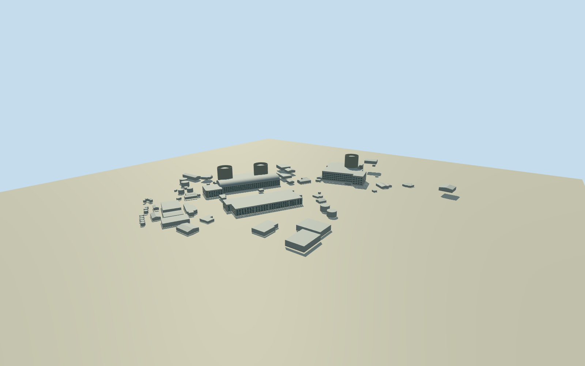

# Mihama nuclear power plant — whole three-unit mapped layout

Whole geographically contiguous Mihama nuclear generating facility in approximate2026mapped layout, including all three native identified units and all71actual mapped building/tank footprints within the industrial facility. Southern connected Units1/2 complex, northern Unit3 reactor/turbine complex, common service/control building, intrinsic process/service ranges and tanks are retained. No extrusion of the255control industrialproperty boundary, ocean, natural rocky peninsula, nearby village, offsite pylons/roads or unrelated structures. Exact currentnative plan supplies complete layout; clear earlyDOEimages supply Units1/2 exterior/roof/containment/casing family. Northern Unit3, unphotographed auxiliary sections, current cladding continuity, all numeric heights/census/grade are architectural estimates and must remain explicit. No claim all71 current exteriors or current decommissioning condition were photographed.

Authoring state: **review-in-qa.json**. Current completion evidence is in [qa.json](qa.json) and the [completion ledger](../../../../qualla-structures/batches/qualla-002.PROGRESS.md).

- [Mihama Nuclear Power Plant: Japan's First Reactor to Break the 40-Year Rule](https://qualla.com/mihama-nuclear-power-plant/)

Whole geographically contiguous Mihama nuclear generating facility in approximate2026mapped layout, including all three native identified units and all71actual mapped building/tank footprints within the industrial facility. Southern connected Units1/2 complex, northern Unit3 reactor/turbine complex, common service/control building, intrinsic process/service ranges and tanks are retained. No extrusion of the255control industrialproperty boundary, ocean, natural rocky peninsula, nearby village, offsite pylons/roads or unrelated structures. Exact currentnative plan supplies complete layout; clear earlyDOEimages supply Units1/2 exterior/roof/containment/casing family. Northern Unit3, unphotographed auxiliary sections, current cladding continuity, all numeric heights/census/grade are architectural estimates and must remain explicit. No claim all71 current exteriors or current decommissioning condition were photographed.

DOE photographs are exact cleared original early1970s/undated Units1/2 views. Actual native2026 footprint data and primary reactor identity/capacity/commissioning text establish whole three-unit scope. All architectural heights, northernUnit3 unphotographed sections, servicebuilding roles, roof subdivisions/finish/window census and current-phase detail continuity remain estimates. No one-unit snapshot completion credit.

Native overlapping buildingrings nearUnit3 can describe parts of one connected complex; preserve originalrings as provenance and resolve roof profiles in geometry without duplicating the plantparcel or changing field/frame. No interiors, reactor machinery, operating simulation, decommissioning equipment or site-security details reconstructed.

Independent original full sourcefield must be fixed before floors/roofs/mainsections and preserved unchanged. Coarse DEM can include buildings/canopy and coastalwater artifacts; grades/foundation contacts are approximate, not surveyed.

All71 nativefootprints retained at close/street/district. Skyline may omit tiny tanks/huts and simplify minor outlines, while retaining allthree distinct shield/dome silhouettes, both mainunitcomplexes/commonrange and majorservice volumes. No repeated one-unit proxy for entireplant.

Original independent field spans absolute-453.9774..61.7139m at4m yarddatum. Deep coastalnegative values and canopy/buildingrelief remain unchanged. Mainplantfloors0/4m and auxiliarygrades are fixed approximations selected after fieldacquisition, not a surveyed bathymetry/foundation model. Shorecliffs can intersect lowshells; no masking, fillplane, cutout or source refit.

Nativecircle fits locate actualthree reactor-shield forms, radius about19.58m. Heights48/51/58m, recessed metaldomes/courses/windows/rooftop details, currentNorthernUnit3 section and auxiliaryfunctions/roof types are explicit architectural estimates. Publishedphotos do not prove currentUnit3 or all71exterior finishes.

DOElocal043/044/045 full originals establish cylindrical concrete shields/recessed hemisphericaltops, flat processroofs/barrelvault turbinehall, metalcladding/ribbonwindows and lower concreteoffice facade. Exactdates/currentcontinuity are unknown. No declaration that current decommissioning equipment, currentpaint or exactwindowcensus was photographed.

Build: `node content/worldgen/source/places/xn/xn2/mihama_nuclear_power_plant/models/generate-house.mjs`. Add `--check` to verify exact regeneration. 35856 triangles; 5 materials; no embedded photographs.
