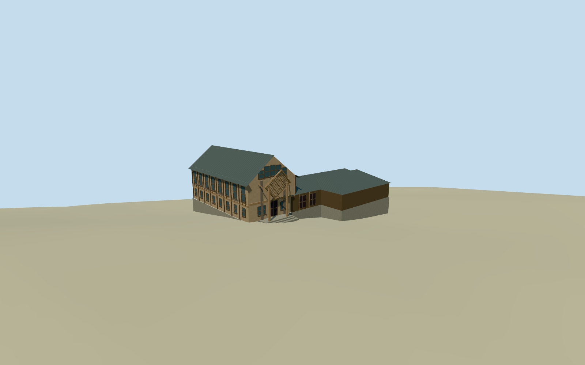

# Chiune Sugihara Memorial Hall

The hinoki memorial hall in Yaotsu, with the diamond-shaped timber lattice, projecting high gable, and attached lower gallery.

Authoring state: **review-in-qa.json**. Current completion evidence is in [qa.json](qa.json) and the [completion ledger](../../../../qualla-structures/batches/qualla-004.PROGRESS.md).

- [Chiune Sugihara Memorial Hall](https://qualla.com/chiune-sugihara-memorial-hall/)

Exterior of the memorial hall and attached low wing. Detached park features, interpretive plaques, interiors and landscaping are outside this asset.

The map fixes the building plan. Roof levels, individual windows and timber spacing are estimates from the two closely spaced photograph angles.

Build: `node content/worldgen/source/places/xn/xn3/chiune_sugihara_memorial_hall/models/generate-chiune-sugihara-memorial-hall.mjs`. Add `--check` to verify exact regeneration. 2988 triangles; 6 materials; no embedded photographs.
