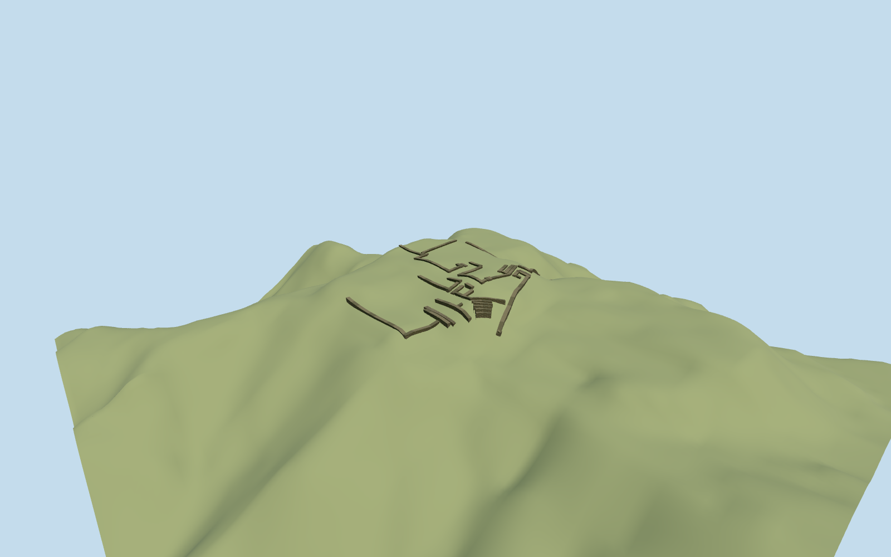

# Iwamura Castle

The surviving Iwamura Castle retaining walls and six-tiered approach, with dry fieldstone faces and stone access steps integrated into the summit terrain.

Authoring state: **review-in-qa.json**. Current completion evidence is in [qa.json](qa.json) and the [completion ledger](../../../../qualla-structures/batches/qualla-003.PROGRESS.md).

- [Iwamura Castle: The Misty Fortress and Its Lady Commander](https://qualla.com/iwamura-castle/)

Surviving upper masonry and paths in the standing hillside ruin. Earlier wooden structures, remote gates and museum interpretation furniture are outside scope.

The six walls are geographically mapped. Their batter, masonry profiles and the rises of individual stones are estimated against the 5-metre terrain and the selected Qualla photographs.

Preserves the unmodified source terrain. Some low foundation remnants and small stair sidewalls are simplified.

Build: `node content/worldgen/source/places/xn/xn3/iwamura_castle/models/generate-iwamura-castle.mjs`. Add `--check` to verify exact regeneration. 12915 triangles; 2 materials; no embedded photographs.
