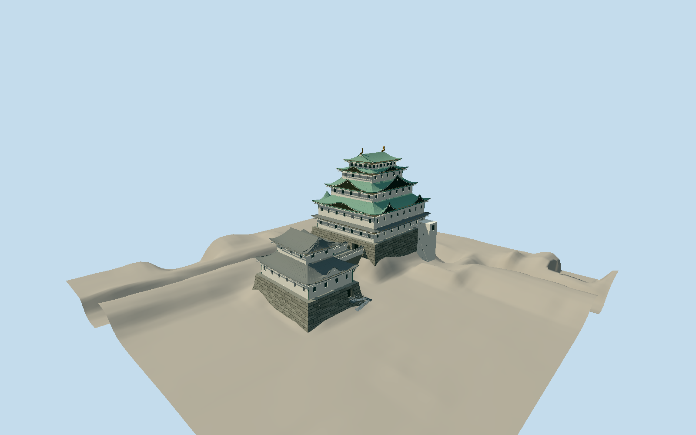

# Nagoya Castle

Present main and offset small keeps with curved fan stone bases, five white main tiers, green copper roofs with curved eaves and varied dark gables, paired gold north/south shachi, two gray tiled small-keep roofs, raised stone connection with white parapets, recessed entrances, narrow exterior dogleg stairs and attached modern east access tower. Separate Honmaru Palace and castle enclosure excluded.

Authoring state: **review-in-qa.json**. Current completion evidence is in [qa.json](qa.json) and the [local 100 ledger](../../../../qualla-structures/batches/PROGRESS.md).

- [Nagoya Castle](https://qualla.com/nagoya-castle/)

Nine actually inspected dated local originals2011–2025 control the present1959 concrete keeps, not the proposed future wooden rebuild. Source photographs/owner illustrations are not redistributed. Palace, detached turrets, gardens, temporary stalls/trees/signs and interiors are excluded.

Native main stone-cap and five tier polygons guide plan and12.48/16.71/23.57/31.07/37.96/41.9m vertical sequence. Approximate48m main/24m small operator visitor figures and2.621m north/2.579m south gold ornaments constrain silhouette.55.6m including stone wall has unspecified endpoints; it is not a terrain-fitting instruction. Lower stone toe, wall/floor offsets, gables, bay counts, stair engineering and unseen details remain authored estimates.

Original GSI elevation PNGs retained unchanged;25663 fine-layer and258 coarse-fallback samples.1m review grid oversamples approximately3.9m/7.8m native pixels. Foundation/hidden-ground classification and epoch are unspecified; no survey accuracy or geodetic transformation claimed. Compatible host terrain is required; default coarse Earth terrain not certified. Footprint replacement disabled.

Build: `node packages/worldgen/scripts/generate-authored-places.mjs --ids=nagoya_castle`. Add `--check` to verify exact regeneration. 56741 triangles; 7 materials; no embedded photographs.
