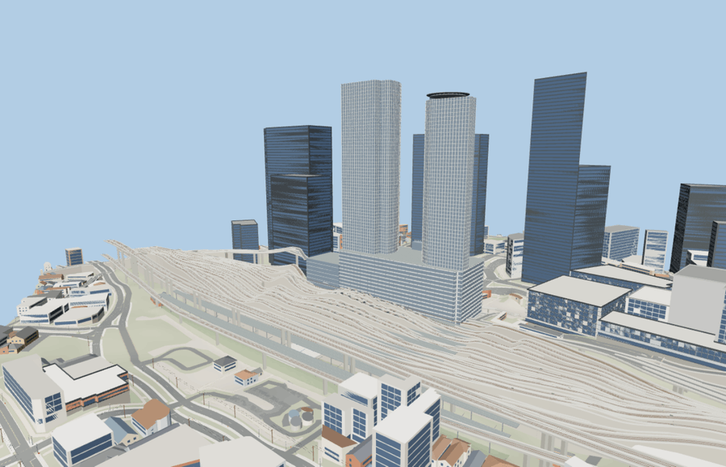

# Nagoya Station

All 9 current portable views actually inspected. Complete principal JR Central Towers passenger ensemble: both distinctive curved towers and flat service returns, unequal roof ends, rounded hotel crown and projecting upper disc with supports, shared podium with repeated pale floor ledges and recessed glazing, uninterrupted central glazed spine, closed entry glazing and actual door frames, shallow street canopy, attached north hall, eight mapped open-sided JR platform canopies and supported transverse concourse. Floors and roofs are closed where occupied; no floor or solid wall fills the railway platform areas. Tower fins keep the same spacing across detailed curve levels. Hidden returns, roof services, entrance details and canopy supports are original medium-fi approximations; no corporate lettering, copied brands, interiors or unrelated nearby towers.

The viewer references the existing south forecourt at about 8.02 m. Bounded grades along the mapped entrance paths and under the eight canopy support rows keep the podium entrances and platforms at grade. The viewer replaces the five owned parts and retains all other 488 local building records and all 578 road and rail records in the focused fixture.

Failed loading preserves the native layers. Eviction restores the ground and releases model geometry.

| Detail level | Triangles | Download bytes | Draws |
| --- | ---: | ---: | ---: |
| skyline | 892 | 72,976 | 1 |
| district | 3,322 | 284,232 | 5 |
| street | 8,012 | 684,044 | 5 |
| closeup | 52,438 | 4,861,992 | 5 |

Skyline and district total 357,208 bytes. Six GLBs pass Khronos validation and contain zero embedded images. Five shared material graphs bind in the viewer. The review covers 72 renders and 100 geographic samples.

The standard urban elevation field supports approximate threshold and platform levels. The model shows the principal JR Central Towers passenger ensemble and the eight mapped platform canopies.

The twin tower heights, hidden service returns and roof equipment remain photo-based approximations. Neighboring towers and independent transport features use their own native geometry.

[Mapped site frame](map-frame.json) · [Terrain fit](site-fit.json) · [QA evidence](qa.json)
