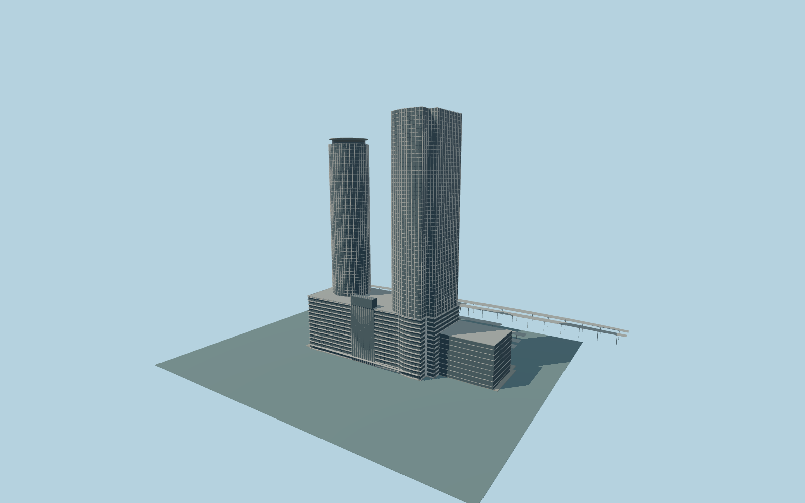

# Nagoya Station

Complete JR Central Towers passenger-building exterior as the main Nagoya Station model:both distinctive curved towers withflatservicebacks,roofcrown/disc,sharedmultilevelpodium,centralglazedspine,terraces/closedentrances andattachednorthhall. Include eightmappedJR platformcanopieswithopen sides/supports behindthebuilding. PreserveJR GateTower,JPTower,Meitetsu/Kintetsu andotherindependentbuildings,roads/rails/platformsurfaces. Originalmedium-fi returns andunseenopeninginventory;no navigableinterior orcopiedbrands.

Rebuild: `node packages/worldgen/scripts/generate-nagoya-station.mjs`;append `--check` for exact source bytes. Select import/LOD/placement with `--ids=nagoya_station`. Detailed source and four browser tiers are separate ignored GLB outputs.

Complete JR Central Towers passenger-building exterior as the main Nagoya Station model:both distinctive curved towers withflatservicebacks,roofcrown/disc,sharedmultilevelpodium,centralglazedspine,terraces/closedentrances andattachednorthhall. Include eightmappedJR platformcanopieswithopen sides/supports behindthebuilding. PreserveJR GateTower,JPTower,Meitetsu/Kintetsu andotherindependentbuildings,roads/rails/platformsurfaces. Originalmedium-fi returns andunseenopeninginventory;no navigableinterior orcopiedbrands.

Native mapped podium47m,office155m andhotel161m part heights are retained with their incomplete elevation semantics. Photo-proportioned source podium60m,north office245m andsouth hotel220m body/226m crown-disc are approximate visualization controls,not surveyed heights. One common unchanged host sample outside the street frontage at local[0,40], 46.516188m suppliesY=0;closed occupied building floors+.35m/support-3m. Platform canopy roofs9m/14m andtransverse concourse8.6m are explicit map/photo-based approximations. No per-part terrain offsets,track replacement or invented outside plaza.

Two ordinary pictures plus standard viewerPMTiles andTerrarium only. No downloaded meshes or bespoke research. Picturefilesremainlocal andarenot textures. Whole principal passenger ensemble only. Deep podium ledges and recessed glazing are modeled; hidden service returns,roof inventory,entrance/crown details andeight platformcanopies are original medium-fi approximations. No copied corporate lettering/brands,navigable interior,independent JR GateTower/JP Tower,Meitetsu/Kintetsu,tracks or platform surface replacement. Coarse standard field hasstrong urban returns;native site acceptance remains pending current field inspection. Physical-device timing andnumerical LOD errors remain unmeasured.

Five existing shared256px concrete,granite,membrane,painted-metal andwindow-grid graphs;five groups maximum. MetricUVs andlinearcolors;no private/embeddedimages. Skyline preserves both distincttowers,podium,northhall,crown andeightcanopies. District addsfacadebanding andsparseverticals. Street addsrecessedpodiumglazing,realfloorledges andentranceframes. Close-up addsstablefins/floorgrid,terracerails andfinercurves. Master preservesfinercurves independently of facadefinspacing.

Original geometry:repository license. Map:© OpenStreetMap contributors,ODbL-1.0;Protomaps. Standard terrain:terrain-grid.json. Ordinary pictures stay local and are not redistributed or used as textures. Current acceptance:qa.json.
