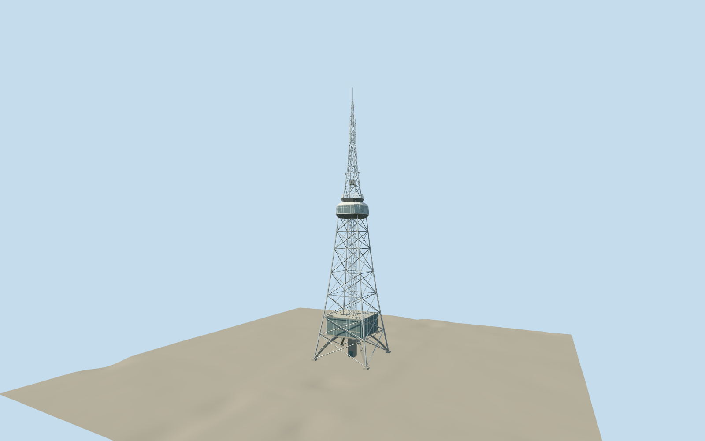

# Nagoya TV Tower

Silver lattice broadcast tower with four splayed legs, suspended glazed floors and paired observation decks in central Nagoya.

Authoring state: **review-in-qa.json**. Current completion evidence is in [qa.json](qa.json) and the [completion ledger](../../../../qualla-structures/batches/qualla-003.PROGRESS.md).

- [Nagoya TV Tower](https://qualla.com/nagoya-tv-tower/)

The April 2011 photographs show the upper tower clearly. Trees obscure the lower building, whose glazed elevations and subdivisions are approximate and use documented levels and structural arrangement.

Steel bay subdivisions, antenna panel fittings, underdeck joists, equipment and balcony fencing are simplified. The 35 m leg spacing, 90 m and 100 m deck heights, and 178.7 m tip follow published dimensions.

The untouched GSI DEM5A field controls footing contact. The alternative Terrarium field was sampled before selection and showed a broad high area at the tower. The Japanese elevation field is the higher-resolution ground product and represents modern park grades.

Build: `node content/worldgen/source/places/xn/xn3/nagoya_tv_tower/models/generate-nagoya-tv-tower.mjs`. Add `--check` to verify exact regeneration. 7272 triangles; 3 materials; no embedded photographs.
