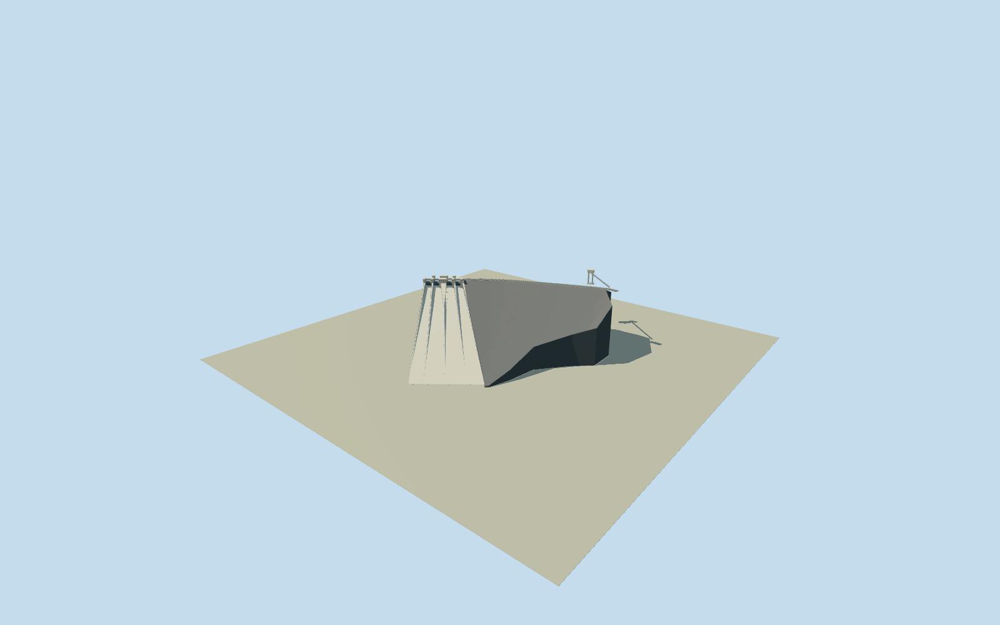

# Tokuyama Dam

Whole surviving TokuyamaDam exterior at actualQ573983 damlocation: rockfill embankment/curvedcrestroad/parapets, intrinsic concrete spillway withfour surfaceradialgatebays/controlboxes andtwo lowerorifice outlets wherevisible, realopen downstreamchannels/highcurveddividerwalls, intrinsic intake/shortservicebridge exterior. Native21controlwholearea andcrestroad for registration; structuralprofile/partboundaries/channelplan/hiddenmechanisms originalboundedestimates informed byfiveexactQuallaCC0originals andprimarynumericfacts. Exclude separate4kmdownstreampowerstation/neighboradministrationcampus, reservoirsurface/naturalhill/anchorednaturalrockfaces/forests/bridge/vehicles/interiors/signage.

Authoring state: **review-in-qa.json**. Current completion evidence is in [qa.json](qa.json) and the [completion ledger](../../../../qualla-structures/batches/qualla-002.PROGRESS.md).

- [Tokuyama Dam](https://qualla.com/tokuyama-dam/)

ActualTokuyamaDam/Q573983/nativearea436904952,21 unique overall damarea controls plus nativecrest/serviceway685595953. Damarea boundary is an overall site/embankment/spillway envelope, not a verticalwall or measuredfoundationcontour. Exactfullroad preserved separately; last9 roadstations traverse spillway/crest/approach, longer than427.1m earthdamcrest duegatebridge/approaches. Fixednativebboxmidpoint/+Xeast/+Zsouth/heading0. Original componentboundaries/spillway/intake registration and structuralsections require bounded interpretation. Storyreference136.47642,35.63422 is the separate downstreampowerstation; use actualdamframewithouteditingstory. Do notsubstitute4kmdownstreampowerhouse/reservoirbridge/naturalhill.

Independent1600m129x129field/16641samples/sixoriginalrawtiles frozen before allfloors/sections/geometry. Flat foundation245m andcrest406m follow primaryowner161mheight/406mcrest facts, relativefixed371.0968m provider datum (foundation-126.0968m/crest34.9032m); no terrain-derived fitting. Native530.098m service-roadpath includes spillway/approaches, not samequantityas427.1m earthdamcrest. Originalbounded interpretation sets embankmentstart atlast427.1m, SW103m gatebridge/hoistcomplex, curved nativecrest/parapets, whole21controlarea partitioned into rockfillbanks andopen spillwayfloor/curveddividerwalls, four16.5m surfacegatebays withwidecentralmonolith, palecontrolboxes, .24m windowvoids, grayradialgatebacks/stiffeners/arms. Originaldownstream.5/upstream.65 structuralprofile, channelplan/widthflare/verticalstations, exactgate/boxdimensions, intake435mstation/-140mupstream/shortservicebridge, hiddenfaces are estimates, not surveyed/borrowedprotectedplan. Primarytwo lowerorificegates are concealedmechanisms, no inventedvisibleoutlets/privateinterior. Nativewholearea isoverall envelope, not a solidflatplate/naturalhill. Exactsourcegrade/contact unresolved; immutablefield/geographicpreview/replaceFootprintfalse.

Wholeactualdam architecture, not4kmdownstreamplant: fullmapped21controlenvelope partitioned intoslopingrockfill andopenconcretespillway, nativecurvedcrest/gatebridge/parapets, foursurfaceradialgatebacks/stiffeners/arms/widecentralmonolith/palecontrolrooms, realopenlongchannelstaperingdividers, intrinsicintake/stiltlegs/servicebridge. Naturalhill/reservoir/forest/upstreamreservoirbridge/administrationcampus/vehicles/interiors/text excluded. Two lowerorificegates are concealedmechanisms recordedasfacts, not inventedvisibleoutlets.

OnlyfiveexactpublishedQualla先従隗始Own/selfCC0 originals individuallyinspected/nativeSHA1matched. Ownernumerictextfacts only, no protectedsectiondrawing/damcard/photo pixels. No sourcearticle/media/rightsmetadata repairs or supplementalphotographs/phototextures. Componentboundary/channelplan/gate/roomdimensions/intakeplacement/structuralprofile/hiddenfaces are original bounded mediumfi estimates.

Independent1600m129x129field/16641samples/sixoriginalrawtiles frozen before allfloors/sections/geometry. Primarycrest406m/foundation245m remain independentstructural references relativefixed371.0968m provider datum; no terrainfit. Exactabutment/footing/waterline/thresholdcontact unresolved, originalfield immutable/geographicpreview/replaceFootprintfalse. Diagnosticflatground cannot seat allslopingdamsections, originalsourcefield inspectedseparately.

Build: `node packages/worldgen/scripts/generate-authored-places.mjs --ids=tokuyama_dam`. Add `--check` to verify exact regeneration. 12481 triangles; 5 materials; no embedded photographs.
