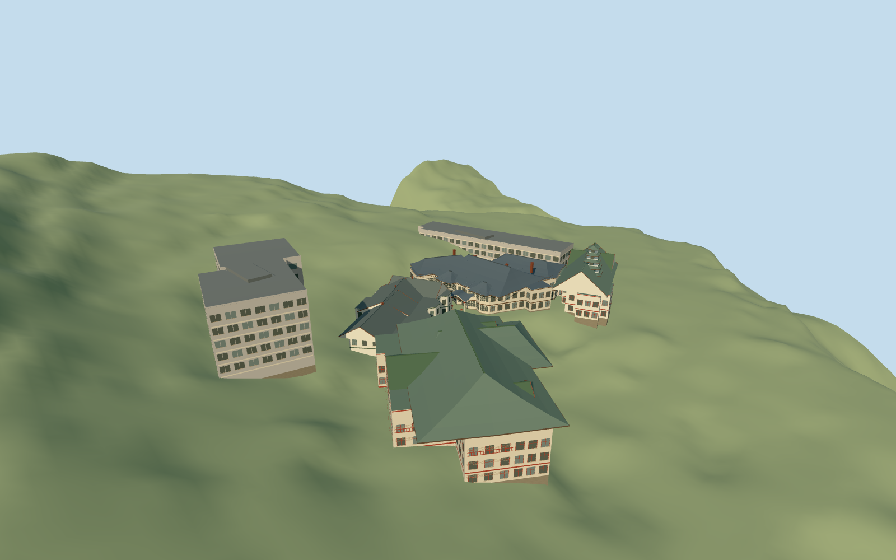

# Fujiya Hotel

Hakone’s Fujiya Hotel, including the 1891 double-bay Main, Dining Room tower, Western cottages, Flower Palace and the newer Forest and Cascade wings.

Authoring state: **review-in-qa.json**. Current completion evidence is in [qa.json](qa.json) and the [completion ledger](../../../../qualla-structures/batches/qualla-003.PROGRESS.md).

- [Fujiya Hotel](https://qualla.com/fujiya-hotel/)

Six principal buildings are modeled in the main compound. The detached Kikka-so across the road, shops, interior fittings and small garden structures are outside scope.

Facade and roof profiles draw from the named current buildings, historic records and the hotel’s restoration descriptions. Later wing heights, balcony sequences, exact trim shades and small windows are approximate.

The discrete building datums follow the national elevation survey. Retaining walls, courtyard steps and interpolated ground beneath the buildings are approximations.

Build: `node content/worldgen/source/places/xn/xn6/fujiya_hotel/models/generate-fujiya-hotel.mjs`. Add `--check` to verify exact regeneration. 16348 triangles; 7 materials; no embedded photographs.
