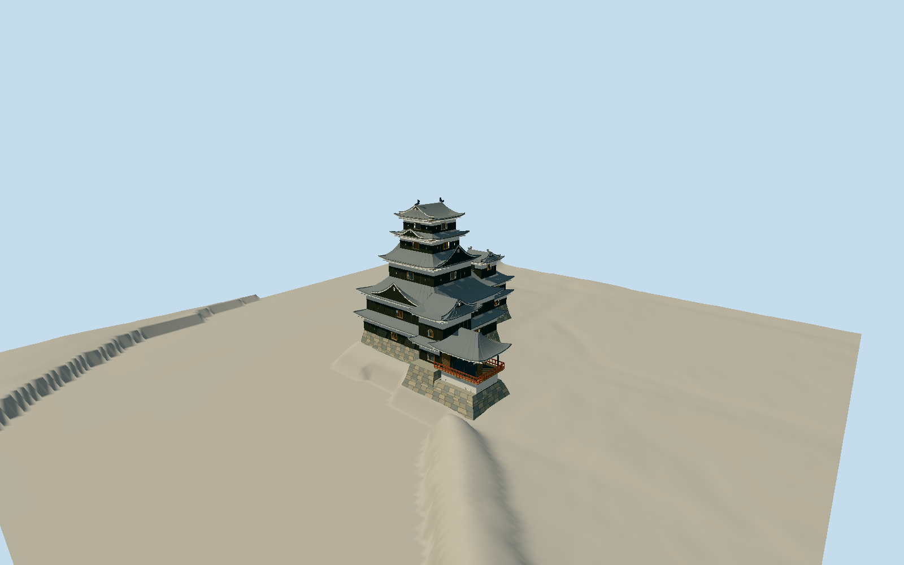

# Matsumoto Castle

Five connected historic structures: black lower weatherboards and pale upper plaster, five main gray tiled roof tiers with broad white-edged triangular/curved gables and gray ridge creatures, three-tier northwest Inui with cusp-headed windows, two-story roofed Watari with recessed stone entrance, southeast Tatsumi wing and genuinely open three-sided red-railed Moon room. Irregular natural-stone bases, projected stone-drop shutters, grouped warrior windows and own entry steps. Detached gates, red moat bridge, town, vegetation and interiors excluded.

Authoring state: **review-in-qa.json**. Current completion evidence is in [qa.json](qa.json) and the [local 100 ledger](../../../../qualla-structures/batches/PROGRESS.md).

- [Matsumoto Castle: The Crow That Refused to Fall](https://qualla.com/matsumoto-castle/)

Unified native outline is a cartographic control, not a measured stone toe, roof eave or individual building-part plan. Component partitions and unseen junctions need photographic/owner-guide interpretation.

Native17m must not be extruded across entire root. Operator visitor-guide approximate main29.4/Inui16.8/Watari12.0/Tatsumi14.7/Tsukimi11.1m labels control relative silhouettes, but vertical endpoints require review.

The first accepted original has snow that obscures tile colours. Current daylight supplements control gray tile/black board/white plaster palette; snow, trees, external red bridge, detached gates, office, town and interiors excluded.

Independent original terrain must be preserved before geometry; no fitting or flattening, and moat source height must not be represented as a surveyed bed or water level.

Operator29.4/16.8/12/14.7/11.1m labels are interpreted as approximate silhouette controls relative to the dry court; precise datum endpoints/individual floor levels are unspecified. Gray shachi heights and ornament are authored estimates, not Nagoya gold measurements.

Approximate owner-guide29.4/16.8/12.0/14.7/11.1m heights interpreted as relative exterior silhouette controls from the dry court. Native whole17m height is not applied to every component. Precise vertical endpoints, floor levels, small gable/ornament geometry, panel counts, inferred toe and stair engineering are estimates. No reconstructed interiors, copied heraldry or photographic pixels.

Six individually inspected local2013–2019 originals and30 contact thumbnails plus both actual operator2018 guide pages constrain exterior. Snow in accepted original is not roof colour. Current repair finishes, hidden interiors and unseen junction details are not surveyed. Gray tile shachi are original simplified forms; south male/north female main pair, with no Nagoya gold dimensions.

Independent original GSI tiles and derived field held unchanged. Roughly half the review grid needs coarser fallback, frequently in/near moat. It is not a surveyed water surface or moat bed; encoding and output spacing are not survey accuracy. Compatible host field required; default coarse Earth terrain and precise ground classification are not certified. Footprint replacement disabled.

Build: `node packages/worldgen/scripts/generate-authored-places.mjs --ids=matsumoto_castle`. Add `--check` to verify exact regeneration. 54286 triangles; 6 materials; no embedded photographs.
