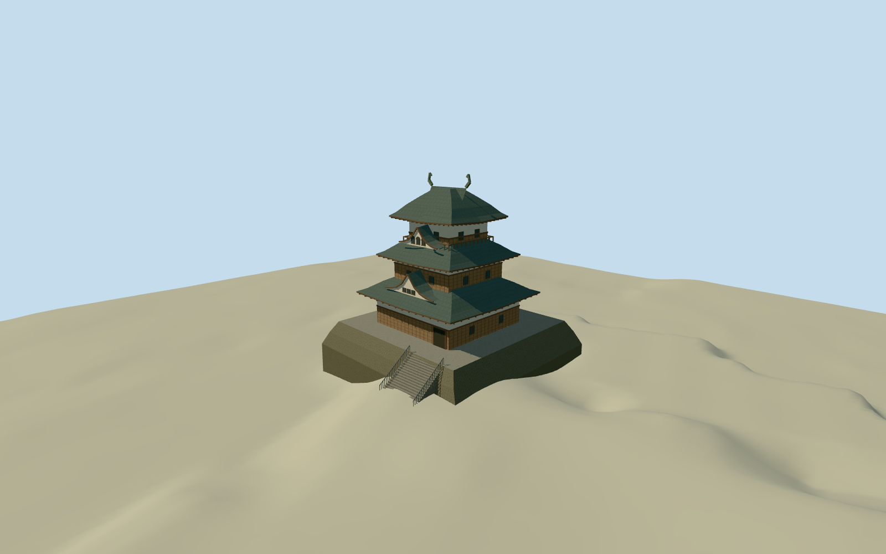

# Takashima Castle

The rebuilt three-tier Takashima keep with bowed copper eaves, timber bands, stone platform and public stair.

Authoring state: **review-in-qa.json**. Current completion evidence is in [qa.json](qa.json) and the [completion ledger](../../../../qualla-structures/batches/qualla-004.PROGRESS.md).

- [Takashima Castle](https://qualla.com/takashima-castle/)

The model depicts the reconstructed keep and adjoining measured corner platform. The separate park gate, turrets and wider enclosure remain outside this scope.

Individual masonry joints, timber trim, parapets and copper ornaments are medium-fidelity approximations.

Build: `node content/worldgen/source/places/xn/xn6/takashima_castle/models/generate-takashima-castle.mjs`. Add `--check` to verify exact regeneration. 4866 triangles; 5 materials; no embedded photographs.
