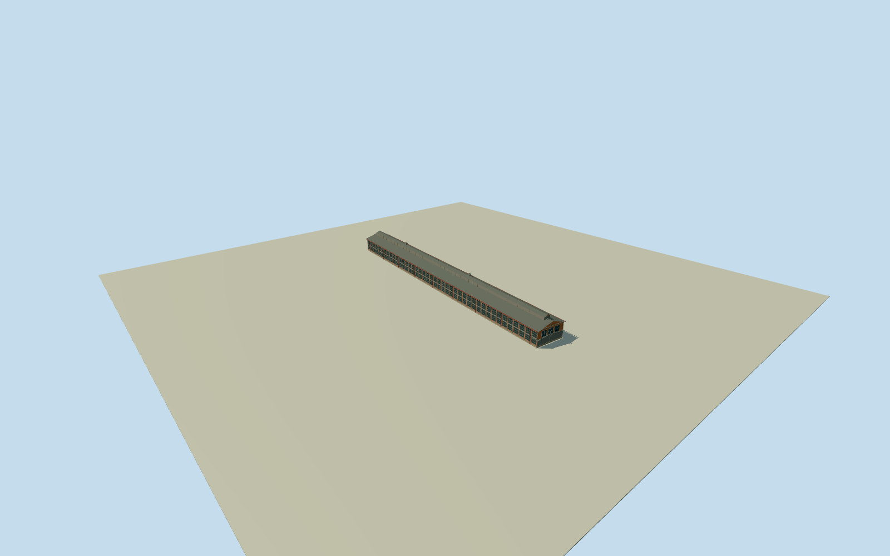

# Tomioka Silk Mill — Silk-reeling Plant

Complete physical timber-framed brick reeling hall, native four-control envelope, long two-tier glazed elevations, gray tiled gable/raised ventilation monitor, stone base, exposed timber and red rainwater fittings. Separate mill warehouses/residences are independent structures and excluded.

Authoring state: **review-in-qa.json**. Current completion evidence is in [qa.json](qa.json) and the [completion ledger](../../../../qualla-structures/batches/qualla-002.PROGRESS.md).

- [Tomioka Silk Mill: The Factory That Frightened Its Workers](https://qualla.com/tomioka-silk-mill/)

All four original native exterior controls of Silk-reeling Plant, way427041089/Q107020325, retained without rectifying the footprint. Site boundary313782668/Q7818931 is not a building outline and is not extruded. Fixed native bbox midpoint/+Xeast/+Zsouth/heading0; independent ground datum set before floor or architectural sections.

Original bounded medium-fi sections chosen only after immutable independent400m field freeze: flatfloor0 relative fixed166.0464m provider datum; stoneplinth.6m/eaves7.7m/mainridge10.3m/monitor12.2m,42pairedtallglazedbays perlongside/.22mactualrecess. Nativeoverallmappedroof-wall envelope151m differsfromoperatorabout140m halllength; noforcedfootprintrectification or surveyclaim. Endlowenclosure/monitorstations/hiddenfacade census simplified estimates from two clearQuallaoriginals; exactgrade/thresholdcontact unresolved. No terrainfitting/flattening/reacquisition.

Physical Silk-reeling Plant Q107020325 only; broader site Q7818931/east and west cocoon warehouses/residences/chimney remain separate uncompleted structures. Exact two published creator-PD/CC0 exterior originals only, no copied photos or generated bitmap textures. Native151m envelope differs from operator about140m length and is not survey geometry. Sections/monitor stations/hidden elevations/opening census/low end enclosure are original bounded estimates. Side windows have physical .22m recesses; end glazing is a closed opaque exterior inset without an interior claim. Fine tile relief/roof ornaments/aging/individual brick layout simplified.

Independent400m129x129 source field,16641 values/two rawtiles frozen before floor0/sections; fixed166.0464m provider datum retained. Exact threshold/footing/grade contact unresolved; geographic preview/replaceFootprint=false. No fitting, flattening, reacquisition, landscaping or surrounding ground plate.

Build: `node content/worldgen/source/places/xn/xn6/tomioka_silk_mill/models/generate-tomioka-silk-mill.mjs`. Add `--check` to verify exact regeneration. 21828 triangles; 6 materials; no embedded photographs.
