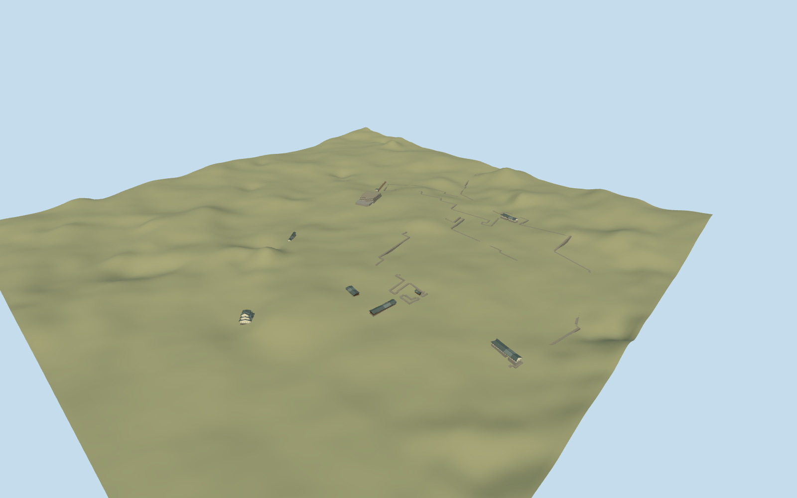

# Edo Castle

Standing Edo Castle remains, including a granite keep foundation, Fujimi tower roofs, timber guardhouses, three gates and battered stone moat walls.

Authoring state: **review-in-qa.json**. Current completion evidence is in [qa.json](qa.json) and the [completion ledger](../../../../qualla-structures/batches/qualla-003.PROGRESS.md).

- [Edo Castle](https://qualla.com/edo-castle/)

The scope is the standing public East Gardens remains. The giant timber tenshu that burned in 1657, the later imperial residence, museum interiors and modern outbuildings are outside the represented scope.

The nine named footprints are mapped. Roof spacing, unsurveyed facing heights, fine tile patterns and the surviving wall batters and courses are approximate.

The original East Gardens terrain is retained. The nearby moat surface and broader landscaping are supplied by Earth context, and original coarse terrain cannot resolve every masonry step.

Build: `node content/worldgen/source/places/xn/xn7/edo_castle/models/generate-edo-castle.mjs`. Add `--check` to verify exact regeneration. 15186 triangles; 6 materials; no embedded photographs.
