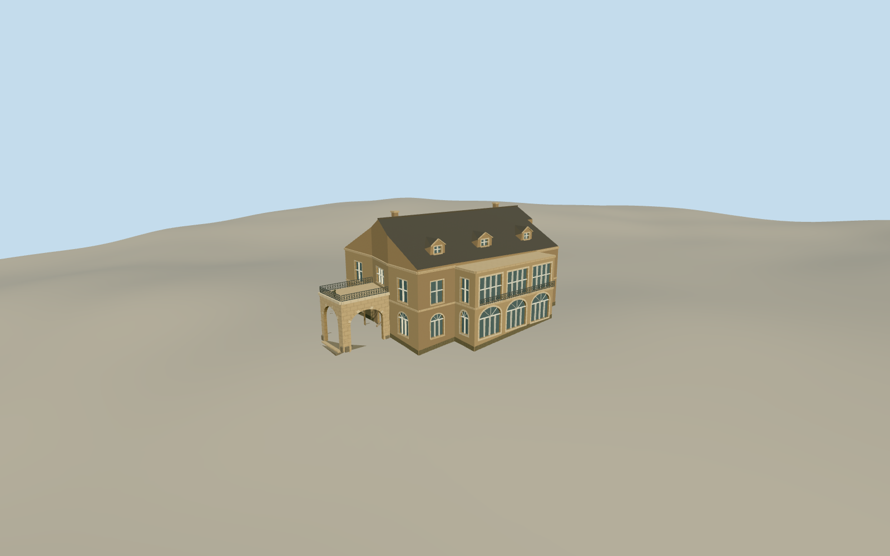

# Hatoyama Hall

Hatoyama Hall in Otowa with pale brick, a dormered roof, glazed garden rooms and a west arched carriage porch.

Authoring state: **review-in-qa.json**. Current completion evidence is in [qa.json](qa.json) and the [completion ledger](../../../../qualla-structures/batches/qualla-003.PROGRESS.md).

- [Hatoyama Hall: Five Generations Under One Roof](https://qualla.com/hatoyama-hall/)

The 2006 entrance photograph sets the west arch, shallow external steps, visible stair and fanlight. Most elevations, roof joins, dormer count, railing and small exterior ornament are estimates.

The operator documents arched lower and four-panel upper openings on the south sunroom. The local outline controls its width and projection. The surrounding garden and the rest of the interior are outside the model scope.

The original elevation samples are unchanged. Footings and approach grades are approximate.

Build: `node content/worldgen/source/places/xn/xn7/hatoyama_hall/models/generate-hatoyama-hall.mjs`. Add `--check` to verify exact regeneration. 11606 triangles; 6 materials; no embedded photographs.
