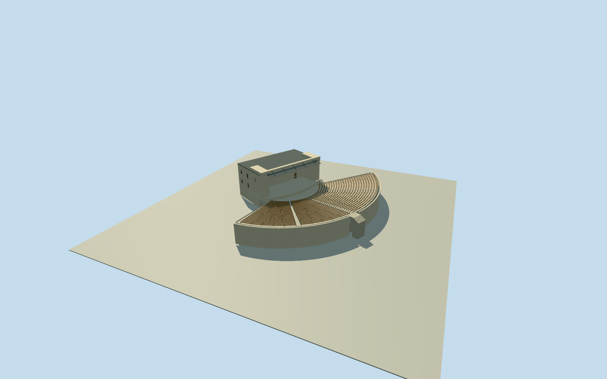

# Hibiya Open-Air Concert Hall (first large hall,1937)

Complete first1923HibiyaLargeOpen-AirConcertHall as publishedin1937: whole highsquareproscenium/broadrecessedstage and acousticbackwall/cantileveredcanopy/sidepylons/realdoorandroundwindowopenings/completehiddenrearandservicebodies/closedroofs/curvedforestage/entirefan-shapedterracedauditorium withallseatrows,retainingwalls,aisles,stairs andaccesslandings. CurrentnamedBigConcertHallnode1588276702/Q11509589/current4controlstage145409065/current15controlbleachers391741587 areapproximateoldsitecontextonly, notmeasured1937geometry. Hiddenhistoricplan/rear/sections/registration/grade/census explicitlyestimated. Exclude1905smallbandstand/current1983stage/1954replacement/brickPublicHallQ11509581/parkstatues/crowds/performers/lettering/interiorart/trees/neighbors.

Authoring state: **review-in-qa.json**. Current completion evidence is in [qa.json](qa.json) and the [completion ledger](../../../../qualla-structures/batches/qualla-002.PROGRESS.md).

- [Hibiya Open-Air Concert Hall: The 10 Yen Revolution](https://qualla.com/hibiya-open-air-concert-hall/)

NativeQ11509589 andnamedcurrentBigConcertHallnode1588276702 withcurrent4controlstage145409065/15controlbleachers391741587 establish approximatefirstlargehallsite. Currentstage/auditorium notmeasured1937survey. ExactSeikaido1937publishedfirst1923largehall source/primaryNDLpdm bound. Completeoldbandshell/rear/servicebodies/fullauditorium/retainingterraces/aisles/stairs required; hiddenplan/roof/sections/census/registration±15m/bearing±12degrees estimated. Do notsubstitute1905smallbandstand/currentstage/brickPublicHallQ11509581. All1077reservations clear.

Full1937firstlargehallstage/back/closedservice-roofs/fullfanauditorium/allterraces/retainingwalls/aisles/stairs required; no stage-onlycrop. PrimaryShowakanseparates1905smallstage/1923large/1954replacement; currentstage/contextnotextrudedunchanged.

ExactSeikaido1937nativePD-Japan-oldphoto+PD-1996/publishedoriginal/primaryNDLcopyrightpdm bound. No copyrightedmodernphotos/maps/nearbybandstand/copiedart/crowds/lettering, generatedbitmap orrightsrepair.

Originalindependent256mfield/frame beforeallfloors/mainsections/geometry, neverflatten/reacquire/reframe/refit afterrender.

Wholehidden1937plan/rear-service-roof/acoustics/sections/seat-aislecount/registration/finish/grade estimated. Exactmetricsurvey notrequired.

Wholehistoricstage33mwide/19.5mdeep, tall12mprosceniumabovestage, projectingcanopy/bracketpositions, backwallcove/radius/door-roundwindowdimension, fullhiddenback/servicefloor-roof areboundedphotographicestimates. Firstlarge1923hall as1937publication, no exactphotodayclaim.

Entirefan24rows/60degreehalfangle/42.38mouterradius/4benchblocks/5aisles/48halfstepsperaisle/outerandsideretainingwalls/2stageentryflights/rearlandingands7stepapproach are explicit wholeauditoriumestimates, notcurrent1983survey. Plaincurvedbenchesnotthousandsofmoderncoloredchairs. Allintrinsicauditorium/stagefloors andretainingparts required, no facadestandin.

PrimaryNDL1937book/pdm and nativeSeikaidoPD-Japan-oldphoto/PD-1996original only. Monochromewallfinish/roofmetal/timbercolors interpreted. No crowd/performers/signage/bookcaption/parkstatues/copiedartwork/trees ornearbybuildings.

Modernsourcefield containscanopy/urbanroofartifacts andmayconceallowerfoundations/retainingwalls. Historicgrade/floorallocation/registration±15m/bearing±12degrees estimated; sourcefield/frame/allmainsections unchanged afterrender.

Build: `node content/worldgen/source/places/xn/xn7/hibiya_open_air_concert_hall/models/generate-house.mjs`. Add `--check` to verify exact regeneration. 42520 triangles; 6 materials; no embedded photographs.
