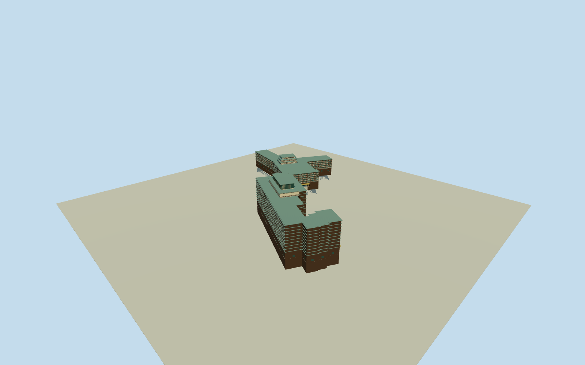

# Hotel Okura Tokyo (Main and South Wings,2006)

Complete old HotelOkuraTokyo in explicit5May2006 historical appearance: whole1962MainWing and1973SouthWing/side and rear accommodation-service bodies/closed roof sections/intrinsic stepped podiums/recessed entrances/room bays/brick lattice-spandrel character/projecting palegreen eave bands and multi-tier rooftop cores/pavilions. Actual13controloldMainWing109502705 and22controloldSouthWing148781270 at2014historicalOSM snapshot give approximate old whole-body context; hidden plan/sections and exact2006registration estimated. Exclude separate museum/USembassy/neighbors/ground estate/current2019Prestige-Heritage replacements, people/cars/trees/copiedsigns/interiors.

Authoring state: **review-in-qa.json**. Current completion evidence is in [qa.json](qa.json) and the [completion ledger](../../../../qualla-structures/batches/qualla-002.PROGRESS.md).

- [The Okura Tokyo: Where James Bond Slept and VHS Was Born](https://qualla.com/hotel-okura-tokyo/)

Q11337851 exactinstitution from nativeWikipedia, historical2014-05-05OSMbuildingways109502705/13controls MainWing and148781270/22controls SouthWing. Both old hotel bodies nowdemolished; source map8yearsafterrepresentedphoto, approximate2006context notsurvey. Unknown narrowseparatehistoricalway148781171 notadopted; museum/USembassy/neighbors/current2019replacement excluded. Main/south wholeenvelopes retained; hiddenplan/sections and exactregistration±10m/bearing±10degrees bounded estimates. All1077every-statusreservations clear.

Complete oldMainWing andSouthWing bodies/rear/side/service ranges/closedroofs required, not only photographedfrontcrop or one wing. Historicalmap building outlines support entire physical scope; exact2006roofplan/section/windowlatticecensus hiddenestimates.

2014map snapshot provides approximate2006oldbuildingcontext. Neveradopt2019Prestige/Heritage replacements or separate museum/USembassy/unknownnarrowadjacentway148781171.

Original independent512mfield/frame must precede all floors/mainsections/geometry; neverflatten/reacquire/reframe orfitmainsections afterrenders.

Two actualsame-date2006originals explicit namedLombrosoOwnwork/PD-self bound; preserveoriginalpublishedQuallabytes/metadata/rights andcreatorcredit. No photographictextures/generatedbitmaps/copiedsigns/people/trees/cars/interiorfurnishings.

Both whole old physical MainWing andSouthWing retain all13+22historical2014controls as approximate2006context. MainY-like rear arms and entire Southstepped returns/service bodies have closed roofs, not cropped facades. Separate museum/neighbors/unknown smallway148781171 not included.

Primary SouthWing original57mheight/13above4below from official25March2015companyrelease, not later2019replacement. Applying57m from chosen historic streetfloor to top is an explicit datum interpretation; exact2006grade, storyheight allocation, main heights, rooftopcorepositions/roof topology/window census are bounded estimates.

Mainentrypavement+.6 and Southlowentry−9.6 fixed beforegeometry; modernsourcefield spans−20.073..18.5673mrelative and may include urban rooftops. Foundations may be concealed and historic contact approximate.

Repetitive brick square spandrel motif, palegreen oversailing eave lips/undersides, cream rooftop boxes and inset windows/portico are photograph-led. Roofbox backs/miterdetails/railpattern/finish and windowcounts estimated. No signs/people/trees/cars/interior murals or copied figurative art.

Build: `node content/worldgen/source/places/xn/xn7/hotel_okura_tokyo/models/generate-house.mjs`. Add `--check` to verify exact regeneration. 55572 triangles; 6 materials; no embedded photographs.
