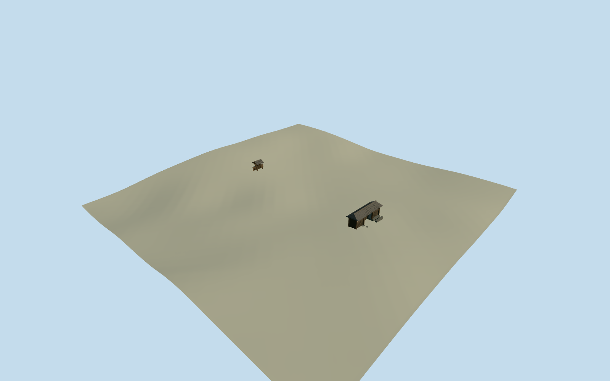

# Iwatsuki Castle

The standing Kuromon and Uramon timber gates at Iwatsuki Castle Park, each on its own mapped footprint.

Authoring state: **review-in-qa.json**. Current completion evidence is in [qa.json](qa.json) and the [completion ledger](../../../../qualla-structures/batches/qualla-004.PROGRESS.md).

- [Iwatsuki Castle](https://qualla.com/iwatsuki-castle/)

The extant two timber gates and the black gate’s immediate stone curb. The vanished castle buildings, park bridge, and earthworks are outside scope.

Heights, timber joint details and the small side panels of the rear gate are estimated from the exact photographs.

Build: `node content/worldgen/source/places/xn/xn7/iwatsuki_castle/models/generate-iwatsuki-castle.mjs`. Add `--check` to verify exact regeneration. 6068 triangles; 7 materials; no embedded photographs.
