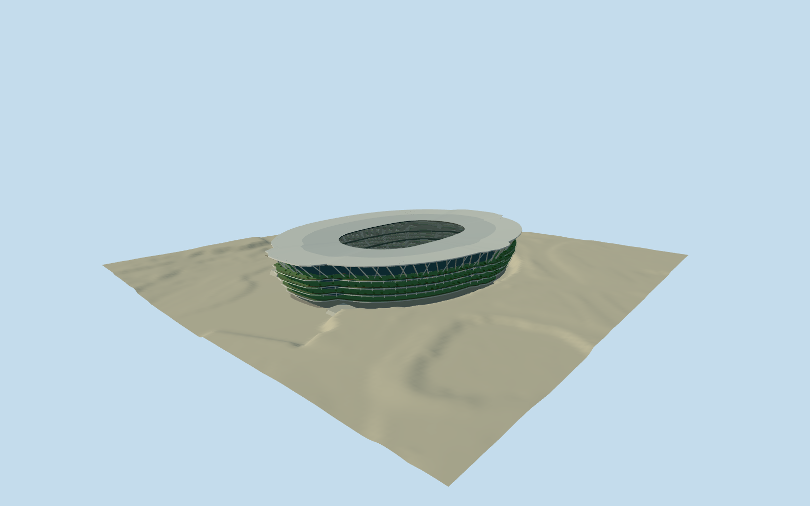

# Japan National Stadium

The Tokyo stadium with a pale open roof, planted timber galleries, inclined white supports, and a nine-lane track around the pitch.

Authoring state: **review-in-qa.json**. Current completion evidence is in [qa.json](qa.json) and the [completion ledger](../../../../qualla-structures/batches/qualla-004.PROGRESS.md).

- [Japan National Stadium: The Stadium That Was Built Twice](https://qualla.com/japan-national-stadium/)

The permanent stadium is modeled without temporary Olympic graphics and event fencing. The roof opening, terraces and bowl proportions follow the native map and public structural records.

Individual seats, small gallery elements and planting species are approximated at Earth-view scale.

Official GSI surveyed elevation controls the exterior concourse. The level athletics surface uses the documented design elevation. The original Mapzen sample is retained for comparison.

Build: `node content/worldgen/source/places/xn/xn7/japan_national_stadium/models/generate-japan-national-stadium.mjs`. Add `--check` to verify exact regeneration. 42718 triangles; 7 materials; no embedded photographs.
