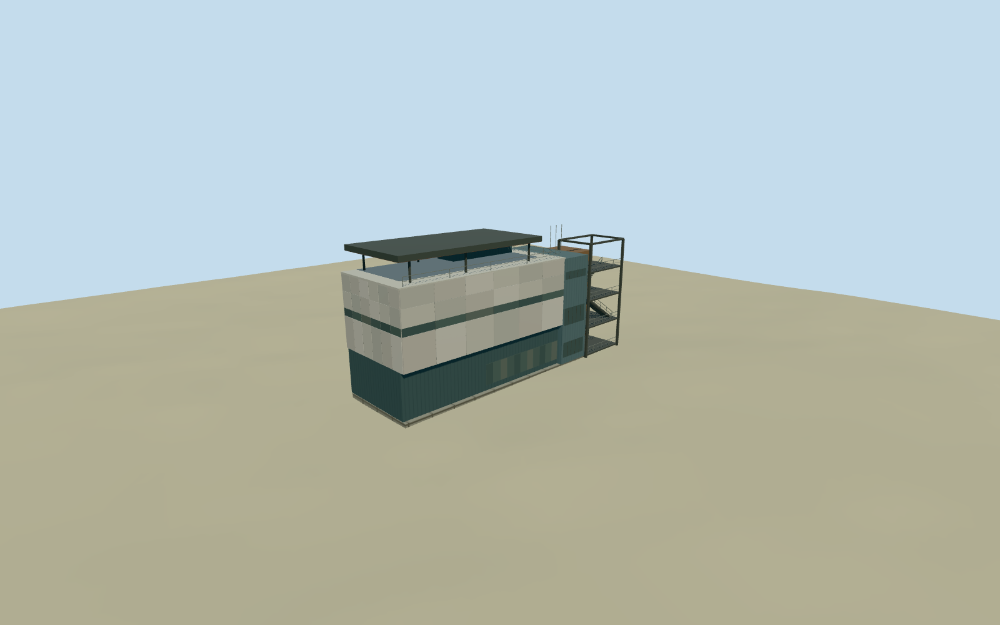

# Motegi Control Tower

Motegi paddock control building with silver curtain wall, dark blue stair bay and open roof shelter.

Authoring state: **review-in-qa.json**. Current completion evidence is in [qa.json](qa.json) and the [completion ledger](../../../../qualla-structures/batches/qualla-004.PROGRESS.md).

- [Mobility Resort Motegi](https://qualla.com/mobility-resort-motegi/)

Models the standalone control tower. The adjacent long pit garages and the separate speedway buildings sit outside scope.

The inset stair framing and facade colors follow the 2008 photograph. Rear openings, small equipment and exact floor heights are approximate.

Build: `node content/worldgen/source/places/xn/xn7/motegi_control_tower/models/generate-motegi-control-tower.mjs`. Add `--check` to verify exact regeneration. 2484 triangles; 6 materials; no embedded photographs.
